# PCI/PII Document Redaction with Azure Document Intelligence and Azure AI Language

This project takes an uploaded document that contains payment card (PCI) or personal (PII) data and returns JSON with the sensitive values masked. Two Azure services do the work:

1. **Azure AI Document Intelligence** reads the document (including scanned pages) and extracts the text.
2. **Azure AI Language** (PII detection) finds sensitive values in that text.

A deterministic rule layer then catches card numbers, CVVs, and expiry dates the Language service misses. A final check blocks the response if any card number or CVV survives masking.

The response contains only masked text and entity metadata (category, position, length, confidence). The original sensitive values are never returned or logged.

> **Status: prototype.** On realistic synthetic statement batches of 500 and 2,000 pages, every planted card number, CVV, and expiry date was masked, along with every SSN, email, and phone number. About 15% of customer names printed in capitals were missed. The 2,000-page batch, the Document Intelligence maximum, took about 1.9 minutes end to end. Live tests of every service limit are documented with screenshots in [Service limit evidence](#service-limit-evidence). CVV and expiry detection rely on Language API *preview* features. Read [Known gaps](#known-gaps) and [Enterprise approach](#enterprise-approach-for-financial-institutions) before using this with real card data.

## Contents

- [Team walkthrough deck](docs/presentation/): 32 slides (PPTX and PDF) covering the whole project, with speaker notes
- [Target-state architecture](#target-state-architecture): logical flow and technical implementation
- [How the pipeline works](#how-the-pipeline-works)
- [Project files](#project-files)
- [Setup and usage](#setup-and-usage)
- [Service limits](#service-limits)
- [Test results](#test-results)
- [Service limit evidence](#service-limit-evidence): screenshots of each limit being hit
- [Known gaps](#known-gaps)
- [Enterprise approach for financial institutions](#enterprise-approach-for-financial-institutions)
- [File size and page recommendations](#file-size-and-page-recommendations)

## Target-state architecture

Two views of the same design:

| View | Shows | Walkthrough |
|------|-------|-------------|
| Logical flow | The 13 steps from job creation to masked JSON, with limits and measured timings | [docs/architecture.md](docs/architecture.md): sequence diagram, time budgets for 500 and 2,000 pages, failure handling |
| Technical implementation | Each Azure service with official Azure icons: what API Management does, which Function runs which check, identities, and networking | [docs/technical-architecture.md](docs/technical-architecture.md): API Management policies, API contract, managed-identity roles |

In both, the size and page checks and the redaction worker are implemented in `languageservice.py`. The other components are the production design and haven't been deployed.

### Logical flow


### Technical implementation on Azure

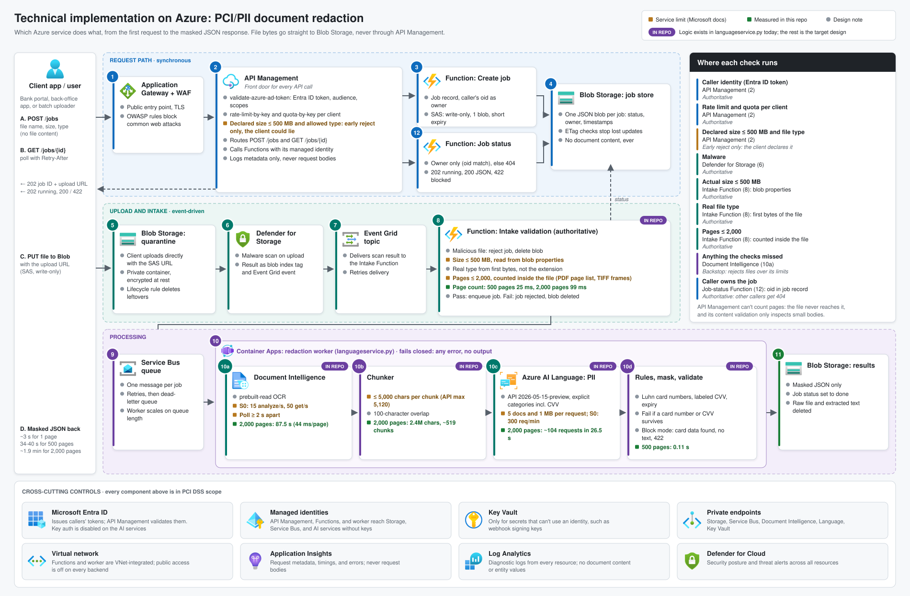

## How the pipeline works

```
PDF / image upload
        |
        v
0. Pre-check, before any Azure AI call
   - size from file metadata: reject if over 500 MB
   - real file type from the first bytes, not the extension
   - pages counted inside the file: reject if over 2,000
     (PDF page list, TIFF frames, single images = 1)
   In this repo: precheck() in languageservice.py
   In production: split between API Management and the Intake Function (see below)
        |
        v
1. Azure AI Document Intelligence (prebuilt-read)                  resource: idpdocgta
        |  extracted text
        v
2. Split into chunks of up to 5,000 characters, ending at line breaks,
   with 100 characters of overlap between chunks
        |
        v
3. Azure AI Language PII detection, REST API 2026-05-15-preview      resource: idpgtalangll
   - explicit category list, including CVV and ExpirationDate
   - 5 chunks per request, 5 requests in parallel
   - retries on HTTP 429 and 5xx (up to 5 attempts), honoring Retry-After
        |
        v
4. Rule layer over the full text
   - 13-19 digit numbers that pass the Luhn check (card numbers)
   - 3-4 digits after CVV / CVC / CVV2 / CID / CSC / Security code
   - month/year after Exp / Expiry / Expiration / Valid thru
        |
        v
5. Mask the union of all detected spans with *
        |
        v
6. Validate: if any Luhn-valid card number or labeled CVV remains, fail
        |
        v
7. PCI policy (--pci-mode)
   - mask (default): return the masked text
   - block: if any card number or CVV was found, return "blocked" and no text
        |
        v
JSON response
```

If the pre-check can't determine the page count, it lets the file through rather than guessing. That covers encrypted or damaged PDFs and Office files. Document Intelligence then enforces its own limit.

#### Where the pre-check runs in production

In production, the client uploads the file straight to Blob Storage with a short-lived upload URL, so API Management never receives the file. The checks are therefore split:

| Check | API Management | Intake Function | Why |
|-------|----------------|-----------------|-----|
| Caller identity, rate limit, quota | Yes | | Decided from the request alone, before anything is stored |
| Size ≤ 500 MB | Early check on the *declared* size | Authoritative check on the *actual* size, from blob properties | The client declares the size to API Management and could lie; the blob's size can't be faked |
| File type | Early check on the *declared* type | Authoritative check from the file's first bytes | Same reason |
| Pages ≤ 2,000 | No | Yes, counted inside the file | API Management never sees the file, and its policies can't parse PDF or TIFF structure |
| Malware | No | No: Defender for Storage scans first, and its clean result triggers the Intake Function | |

`precheck()` in `languageservice.py` is the Intake Function's logic. API Management's checks are configuration (policies), shown in [docs/technical-architecture.md](docs/technical-architecture.md#what-api-management-does). More detail: [How the size and page checks work](docs/architecture.md#how-the-size-and-page-checks-work).

The pipeline **fails closed**. If any Language request fails, any chunk returns an error, or the final check finds a surviving card number or CVV, it returns `{"status": "error"}` and no text at all. The error message never includes document content.

### Categories requested

| Group | Categories |
|-------|------------|
| Payment card | `CreditCardNumber`, `CVV` (preview), `ExpirationDate` (preview) |
| Bank and tax | `USBankAccountNumber`, `BankAccountNumber` (preview), `ABARoutingNumber`, `SWIFTCode`, `InternationalBankingAccountNumber`, `USSocialSecurityNumber`, `USIndividualTaxpayerIdentification` |
| Personal | `Person`, `Email`, `PhoneNumber`, `Address`, `DateOfBirth` (preview) |

To change the list, edit `PII_CATEGORIES` in `languageservice.py`.

General categories such as `Organization` and `DateTime` are left out on purpose. On transaction-heavy documents they mask merchant names and every transaction date, which buries the sensitive values. The service sometimes still labels an expiry date as `DateTime`; that entity is masked like any other.

### Why the REST API instead of the SDK

The `azure-ai-textanalytics` SDK (5.4.0, the latest release) supports Language API versions up to `2023-04-01`. That version has no `CVV` or `ExpirationDate` category. The pipeline calls the REST API directly so it can use `2026-05-15-preview`.

## Project files

| File | Purpose |
|------|---------|
| `languageservice.py` | The pipeline. Run it on a file, or import `process_document(path)` |
| `scripts/generate_banking_pdf.py` | Generates a realistic synthetic batch of credit card statements (500 pages by default, any size with `--pages`) and a ground-truth file listing every planted value |
| `scripts/score_results.py` | Scores pipeline output against the ground truth |
| `scripts/benchmark.py` | Times each stage, and compares 1 worker with N parallel workers for Language calls |
| `scripts/test_precheck.py` | Tests the size and page-count pre-check offline, including PDFs and TIFFs at and over the 2,000-page limit |
| `scripts/probe_pii_categories.py` | Calls the Language REST API to compare what each API version detects |
| `scripts/test_service_limits.py` | Deliberately exceeds each Document Intelligence and Language limit against the live services and saves transcripts |
| `scripts/render_evidence.py` | Renders the transcripts as screenshots in `docs/evidence/` |
| `docs/evidence/` | Service-limit screenshots, transcripts, and sample test pages. See [Service limit evidence](#service-limit-evidence) |
| `scripts/render_architecture.py` | Generates `docs/architecture.svg` (logical flow) |
| `scripts/render_technical_architecture.py` | Generates `docs/technical-architecture.svg` (technical implementation, with Azure icons) |
| `docs/architecture.md` | Logical flow, step by step |
| `docs/technical-architecture.md` | Technical implementation: services, API Management policies, API contract, identities |
| `scripts/build_presentation.py` | Generates the team walkthrough deck in `docs/presentation/` (PPTX, plus PDF if LibreOffice is installed) |
| `docs/presentation/` | Team walkthrough deck: the whole project in 32 slides, with speaker notes |
| `docs/icons/azure/` | Official Azure architecture icons used in the technical diagram, with Microsoft's terms of use |
| `sample_pci_test.pdf` | One-page test form with public test card numbers and sample CVVs. Not real accounts |
| `requirements.txt` | Pinned dependencies |
| `test_data/` | Synthetic statement batches (500 and 2,000 pages), their ground-truth files, a clean 1-page document, and pipeline output. See [Test documents](#test-documents) |
| `.env` | Endpoints and keys. Not committed |

## Setup and usage

1. Create `.env` in the project root:

   ```
   AZURE_DOCINTEL_ENDPOINT=https://idpdocgta.cognitiveservices.azure.com/
   AZURE_DOCINTEL_KEY=<Document Intelligence key>
   AZURE_LANGUAGE_ENDPOINT=https://idpgtalangll.cognitiveservices.azure.com/
   AZURE_LANGUAGE_KEY=<Language key>
   ```

   Each key must belong to the resource at the matching endpoint. A Document Intelligence key does not work against the Language API. The mismatch returns `401 Access denied due to invalid subscription key or wrong API endpoint`.

2. Install dependencies:

   ```
   pip install -r requirements.txt
   ```

3. Run the pipeline:

   ```
   python languageservice.py sample_pci_test.pdf                    # mask card data (default)
   python languageservice.py sample_pci_test.pdf --pci-mode block   # reject documents with card data
   ```

   The exit code is 0 when the pipeline completes, whether the result is masked or blocked, and 1 on a pipeline error. Which mode to use is a business decision: see [Mask or block](docs/technical-architecture.md#4-mask-or-block-a-business-decision).

4. Optional: reproduce the tests. The test documents are already in `test_data/`:

   ```
   python languageservice.py test_data/banking_statements_500p.pdf > test_data/results_500p.json
   python scripts/score_results.py test_data/results_500p.json test_data/ground_truth_500p.json
   python languageservice.py test_data/banking_statements_2000p.pdf > test_data/results_2000p.json
   python scripts/score_results.py test_data/results_2000p.json test_data/ground_truth_2000p.json
   python languageservice.py test_data/banking_statements_500p.pdf --pci-mode block
   python scripts/benchmark.py test_data/banking_statements_500p.pdf
   python scripts/test_precheck.py
   python scripts/test_service_limits.py      # live limit tests; some are billed
   python scripts/render_evidence.py          # screenshots from the transcripts
   ```

   To regenerate the documents (output is identical each time):

   ```
   python scripts/generate_banking_pdf.py                # 500 pages
   python scripts/generate_banking_pdf.py --pages 2000   # 2,000 pages
   ```

### Example output (`sample_pci_test.pdf`, entities shortened)

```json
{
  "status": "ok",
  "source_file": "sample_pci_test.pdf",
  "file_type": "pdf",
  "size_bytes": 1973,
  "pages": 1,
  "characters": 430,
  "language_api_version": "2026-05-15-preview",
  "language_model_versions": ["2026-05-01"],
  "timings": {"precheck_s": 0.037, "document_intelligence_s": 2.5, "language_s": 0.3},
  "pii_detected": true,
  "category_counts": {"Address": 1, "CVV": 2, "CreditCardNumber": 2, "DateTime": 2, "Email": 1, "Person": 2, "PhoneNumber": 1},
  "rule_only_detections": 0,
  "entity_count": 11,
  "entities": [
    {"category": "CreditCardNumber", "source": "language", "confidence_score": 1.0, "offset": 225, "length": 19, "masked_value": "*******************"}
  ],
  "masked_text": "PAYMENT CARD AUTHORIZATION FORM (TEST DATA ONLY)\nCustomer Name: *********** ... Card Number: ******************* Expiration Date: ***** CVV: *** ..."
}
```

| Field | Meaning |
|-------|---------|
| `source` | `language` (found by Azure AI Language) or `rule` (found only by the rule layer) |
| `rule_only_detections` | Values only the rule layer caught. A non-zero count means the Language service missed something, so track it over time |
| `language_api_version`, `language_model_versions` | Recorded for audit |
| `file_type`, `size_bytes` | From the pre-check. The type is detected from the file's first bytes |
| `timings` | Seconds spent in the pre-check, Document Intelligence, and Language |

In block mode, a document containing card data returns no text and no entity positions. The API layer maps this to HTTP `422`:

```json
{
  "status": "blocked",
  "reason": "Payment card data detected",
  "source_file": "sample_pci_test.pdf",
  "pages": 1,
  "pci_categories_found": ["CVV", "CreditCardNumber"],
  "timings": {"precheck_s": 0.037, "document_intelligence_s": 2.5, "language_s": 0.3}
}
```

This is the output from the live run on `sample_pci_test.pdf`. See [Block mode](#block-mode) for the other results.

## Service limits

All limits are for the Standard tiers (Document Intelligence S0; Language S0 and S). They were checked against Microsoft's documentation in November 2026. Limits change, so re-check the linked pages before you design around them.

### Document Intelligence, Read model (S0)

Source: [Document Intelligence service quotas and limits](https://learn.microsoft.com/en-us/azure/ai-services/document-intelligence/service-limits)

| Limit | Value | Adjustable |
|-------|-------|------------|
| Max document size | 500 MB | No |
| Max pages per analysis | 2,000. **Tested: a longer file is not rejected; only the first 2,000 pages are analyzed, with no error** | No |
| Analyze requests (POST) per second | 15 | Yes, by support request |
| Get-result requests (GET) per second | 50 | Yes, by support request |
| Max OCR JSON response | 500 MB | No |
| Recommended polling interval | At most once every 2 seconds per request | n/a |

- Billing is per page. For PDF and TIFF, each page counts as one page.
- The `pages` parameter (for example `"1-100"`) analyzes a page range instead of the whole file.
- Supported file types for Read: PDF, JPEG, PNG, BMP, TIFF, HEIF, DOCX, PPTX, XLS.

### Azure AI Language, PII detection

Source: [Language service data limits](https://learn.microsoft.com/en-us/azure/ai-services/language-service/concepts/data-limits)

| Limit | Value |
|-------|-------|
| Characters per document, synchronous API | 5,120 (measured in text elements) |
| Documents per request, synchronous API | 5 |
| Documents per request, asynchronous API | 25, with a total of 125,000 characters across all documents |
| Max request size | 1 MB |
| Rate limit, S0 tier | 100 requests per second, 300 per minute |
| Rate limit, S tier | 1,000 requests per second, 1,000 per minute |
| Billing unit | 1 text record = 1,000 characters (billing only, not a cap) |

What happens when a limit is exceeded, according to Microsoft's documentation and confirmed by the [live tests](#service-limit-evidence):

- **Synchronous:** an oversized document gets an invalid-document error, and the other documents in the request are still processed.
- **Asynchronous:** the whole request is rejected. The documentation says `400 Bad Request`; the live test of the 125,000-character total got `413 Payload Too Large`.

The pipeline uses 5,000-character chunks and 5 chunks per request (at most about 25,000 characters, well under 1 MB), which stays inside the synchronous limits.

### API versions

Source: [PII entity categories](https://learn.microsoft.com/en-us/azure/ai-services/language-service/personally-identifiable-information/concepts/entity-categories)

| API | Version | Notes |
|-----|---------|-------|
| Language, used by this pipeline | `2026-05-15-preview` | Required for `CVV`, `ExpirationDate`, `BankAccountNumber`, and `DateOfBirth`. Subject to Microsoft's preview terms |
| Language, current GA | `2026-05-01` | Does not detect CVVs (tested, see below) |
| Document Intelligence SDK | `azure-ai-documentintelligence` 1.0.2 | |

## Test results

All tests ran on November 22, 2026, against the `idpdocgta` (Document Intelligence) and `idpgtalangll` (Language) resources in East US, from a single laptop. The pricing tiers were confirmed by the services' own rate-limit messages: **Document Intelligence S0** and **Language S**. Where a measurement was repeated, the range across runs is shown.

### Test documents

Both test documents are committed in `test_data/` and were generated by `scripts/generate_banking_pdf.py`. Each one is a realistic batch of monthly credit card statements, the kind of file a bank's statement or back-office system produces:

- **Every statement** has an account summary page, 1 to 4 transaction pages, an interest and fees page, and a disclosures page.
- **Card numbers on ordinary pages are already masked**, as on real statements: "Card ending in 4444" and "XXXX XXXX XXXX 4444".
- **Full card data appears only on occasional forms** attached to about one statement in five: card dispute forms, recurring payment authorizations, and balance transfer requests. Each form has a cardholder name, email, phone, SSN, full card number, expiry date, and CVV.
- **The forms sit at irregular positions**, not on a fixed schedule.

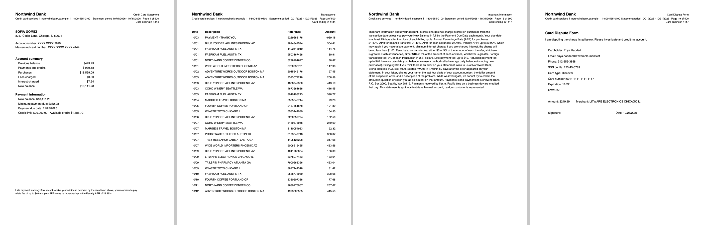

| Property | `banking_statements_500p.pdf` | `banking_statements_2000p.pdf` |
|----------|-------------------------------|--------------------------------|
| Pages | 500 | 2,000 (the Document Intelligence maximum) |
| File size | 752 KB | 3.0 MB |
| Statements | 84 | 330 |
| Pages by type | 84 summary, 224 transactions, 83 fees, 83 disclosures, 26 forms | 330 summary, 936 transactions, 329 fees, 329 disclosures, 76 forms |
| Pages with full card data | 26 (5.2% of pages), 6 to 38 pages apart | 76 (3.8% of pages), 6 to 135 pages apart |
| Extracted text | 598,991 characters (about 1,198 per page) | 2,437,253 characters (about 1,219 per page) |
| Ground truth | `ground_truth_500p.json` | `ground_truth_2000p.json` |
| Pipeline output | `results_500p.json` (mask), `results_500p_block.json` (block) | `results_2000p.json` (mask) |

All data is fictional. Card numbers are public test numbers (Visa, Mastercard, American Express, Discover). Names, addresses, and accounts are made up. SSNs are widely published example numbers (`123-45-6789`, `078-05-1120`, `219-09-9999`) that are not issued to real people.

### Detection accuracy

Scored with `scripts/score_results.py`. For each form field, the scorer reads the value after the label in the masked output and counts a leak if it matches a planted value exactly.

| Value on the forms | Leaked, 500 pages | Leaked, 2,000 pages | Detected by |
|--------------------|-------------------|---------------------|-------------|
| Card number | 0 / 26 | 0 / 76 | Language (`CreditCardNumber`) |
| CVV | 0 / 26 | 0 / 76 | Language (`CVV`) |
| Expiry date | 0 / 26 | 0 / 76 | Language (`DateTime`) |
| SSN | 0 / 26 | 0 / 76 | Language (`USSocialSecurityNumber`) |
| Email | 0 / 26 | 0 / 76 | Language (`Email`) |
| Phone | 0 / 26 | 0 / 76 | Language (`PhoneNumber`) |
| Cardholder name | 0 / 26 | **1 / 76** | Language (`Person`) |

Names on the statement summary pages, which are printed in capitals, were checked separately against the generator's page plan:

| Value on summary pages | Not masked, 500 pages | Not masked, 2,000 pages |
|------------------------|-----------------------|-------------------------|
| Customer name, in capitals | **13 / 84 (15%)** | **51 / 330 (15%)** |
| Customer address | 0 / 84 | 0 / 330 |

What this shows:

- **All card data was masked.** Every card number, CVV, and expiry date on every form was masked in both documents. The rule layer found nothing extra (`rule_only_detections: 0`), so the Language service caught all of it.
- **Names are the weak spot.** About 15% of customer names printed in capitals were not recognized as names, and one mixed-case cardholder name on a form ("Zara Walsh", page 1,342) was missed. This is a personal-data gap, not a card-data gap. See [Known gaps](#known-gaps).
- **Already-masked references are left alone.** "Card ending in 4444" stays readable, which is correct: the last four digits aren't card data under PCI DSS masking rules.

All entities returned, which shows how much the pipeline masks beyond the planted values:

| Category | 500 pages | 2,000 pages | What was masked |
|----------|-----------|-------------|-----------------|
| `PhoneNumber` | 5,280 | 22,848 | Mostly the 10-digit transaction reference numbers, plus planted phones and the bank's phone number |
| `Address` | 1,958 | 8,231 | Customer addresses and the merchant locations in transaction descriptions |
| `BankAccountNumber` | 136 | 555 | Account and reference numbers |
| `Person` | 104 | 383 | Customer and cardholder names |
| `CreditCardNumber` | 32 | 112 | 26 and 76 planted. The other detections were not investigated |
| `CVV`, `DateTime`, `Email`, `USSocialSecurityNumber` | 26 each | 76 each | Exactly the planted values |
| **Total** | **7,614** | **32,433** | |

Over-masking is safe for PCI but makes the output much less useful: masking every transaction reference number hides information operations teams need.

### Processing time

Measured with `scripts/benchmark.py` and `python languageservice.py`:

| Stage | 1-page form | 500-page batch (752 KB) | 2,000-page batch (3.0 MB) |
|-------|-------------|-------------------------|---------------------------|
| Characters extracted | 430 | 598,991 | 2,437,253 |
| Chunks / Language requests | 1 / 1 | 128 / 26 | about 519 / 104 |
| Size and page pre-check | 37 ms | 62 ms | 138 ms |
| Document Intelligence | 2.5 s | 27.4 to 28.5 s (3 runs, 55 to 57 ms per page) | 87.5 s (44 ms per page) |
| Language PII, 5 parallel requests | 0.3 s | 6.5 to 11.6 s (3 runs) | 26.5 s |
| Language PII, 1 request at a time | 0.3 s | 24.4 s | Not measured |
| Rules, masking, validation | under 0.01 s | 0.11 s | Not timed separately |
| **End to end** | **2.8 s** | **34.4 to 40.3 s (3 runs)** | **114.9 s, about 1.9 minutes (wall clock)** |

| Observation | Detail |
|-------------|--------|
| Document Intelligence dominates | It took 87.5 of the 114.9 seconds at 2,000 pages, about three quarters of the total |
| Larger files ran faster per page | 44 ms per page at 2,000 pages, against 55 to 57 ms at 500 pages |
| Parallel Language calls matter | The same 26 requests took 24.4 s one at a time and 6.9 s with 5 in parallel, about 3.5 times faster |
| Language stays well inside its rate limit | About 104 requests in 26.5 s is about 235 per minute. The S tier allows 1,000; the S0 tier's 300 would also have been enough |
| Rules and validation are cheap | 0.11 s for 500 pages |
| Connections from the test machine were unreliable | 17% to 23% of new TLS connections to both services failed in the handshake (60-request samples). Two runs failed this way before retries were added. With the retries now in `languageservice.py`, every run completed. See [Known gaps](#known-gaps) |

These numbers are for text PDFs. Scanned PDFs need full OCR and are usually much larger files, so expect them to be slower. They were not measured here. Test with your own scanned samples before you size anything.

### Size and page pre-check

Tested with `scripts/test_precheck.py`, which runs offline and makes no Azure calls. It checks the three committed test documents, and generates edge cases right at and just over the limits: blank-page PDFs and multi-frame TIFFs at 2,000 and 2,001 pages, plus files the pre-check can't count.

| File | Size | Type detected | Pages counted | Expected | Result | Check time |
|------|------|---------------|---------------|----------|--------|------------|
| 1-page form (`sample_pci_test.pdf`) | 2 KB | PDF | 1 | Pass | Pass | 4 ms |
| 500-page statement batch | 752 KB | PDF | 500 | Pass | Pass | 24 ms |
| 2,000-page statement batch (at the limit) | 3.0 MB | PDF | 2,000 | Pass | Pass | 99 ms |
| PDF, 2,000 blank pages (at the limit) | 244 KB | PDF | 2,000 | Pass | Pass | 57 to 76 ms |
| PDF, 2,001 blank pages (over the limit) | 244 KB | PDF | 2,001 | Reject | Reject | 57 ms |
| TIFF, 3 frames | under 1 KB | TIFF | 3 | Pass | Pass | 1 ms |
| TIFF, 2,001 frames (over the limit) | 250 KB | TIFF | 2,001 | Reject | Reject | 84 to 86 ms |
| PNG image | under 1 KB | PNG | 1 | Pass | Pass | 1 ms |
| Damaged PDF | under 1 KB | PDF | Can't be read | Pass to Document Intelligence | Pass | 1 ms |
| Text file | under 1 KB | Other | Not counted | Pass to Document Intelligence | Pass | under 1 ms |

All 10 cases behaved as expected. The pre-check matters more than it first appears: [Service limit evidence](#service-limit-evidence) shows that Document Intelligence does not reject a file with more than 2,000 pages.

### Block mode

`--pci-mode block` was run live against both services:

| Document | Result | Time |
|----------|--------|------|
| `sample_pci_test.pdf` (card numbers, expiry dates, CVVs) | `blocked`, with `CVV` and `CreditCardNumber` found. No text and no entity positions returned | Document Intelligence 2.5 s, Language 0.3 s |
| Clean 1-page document (`test_data/clean_1p.pdf`) | `ok` | Document Intelligence 3.5 s, Language 0.2 s |
| 500-page statement batch | `blocked`, with `CVV` and `CreditCardNumber` found. No text and no entity positions returned | Document Intelligence 28.5 s, Language 6.5 s |

An offline test with an empty Language response also blocked the card sample, which shows the rule layer alone can trigger a block.

### API version comparison

`scripts/probe_pii_categories.py` sent `Card number: 4111 1111 1111 1111. Expiration: 04/28. CVV: 123.` to the Language REST API:

| API version | Card number | Expiry `04/28` | CVV `123` |
|-------------|-------------|----------------|-----------|
| `2026-05-01` GA, default categories | Masked | Masked (as `DateTime`) | **Not masked** |
| `2026-05-15-preview`, explicit categories including `CVV` | Masked | Masked (as `DateTime`) | Masked (as `CVV`) |

This is why the pipeline uses the preview API with an explicit category list.

## Service limit evidence

`scripts/test_service_limits.py` deliberately exceeds each documented limit against the live services and saves a transcript of what was sent and what came back. It calls the services directly, bypassing this pipeline's own pre-check, so the services' own enforcement is what's tested. `scripts/render_evidence.py` renders each transcript as a screenshot.

The screenshots show the saved transcripts exactly; only colors and layout are added. The plain-text transcripts are in [`docs/evidence/logs/`](docs/evidence/logs/). They contain no keys and no document content.

### Summary

| # | Documented limit | What was sent | What the service did | Verdict |
|---|------------------|---------------|----------------------|---------|
| 1 | Document Intelligence: 2,000 pages per analysis | A 2,001-page PDF | Accepted it (`202`), reported `succeeded`, and returned **2,000 pages**. The last page was dropped with no error or warning | **Not rejected: silently truncated** |
| 2 | Document Intelligence: 500 MB per document | A 501 MiB upload | `400 InvalidContentLength`, "The input image is too large", after only 160 KB was sent | Enforced up front |
| 3 | Document Intelligence: 15 analyze requests per second (S0) | 60 requests, 30 in parallel | 25 accepted, 25 refused with `429` ("FormRecognizer S0 pricing tier"), `Retry-After: 1` | Enforced |
| 4 | Language: 5,120 characters per document (synchronous) | One 6,000-character and one 500-character document | `200`. The long document got `InvalidDocument` ("Limit document size to: 5120 text elements"); the short one was processed | Enforced per document |
| 5 | Language: 5 documents per synchronous request | 6 documents | `400 InvalidDocumentBatch`, "Max 5 records are permitted" | Enforced |
| 6 | Language: 25 documents per asynchronous job | 26 documents | `400 InvalidDocumentBatch`, "Max 25 records are permitted" | Enforced |
| 7 | Language: 125,000 characters per asynchronous job | 25 documents of 5,100 characters (127,500) | `413`, "Limit request size to: 125000". Microsoft's data-limits page says `400` | Enforced, with a different status code than documented |
| 8 | Language: 1,000 requests per minute (S tier) | 1,100 requests, 40 in parallel | 585 accepted, 505 refused with `429` ("TextAnalytics S pricing tier"), `Retry-After: 45` | Enforced |
| 9 | This pipeline's pre-check | A 2,001-page PDF and a 501 MiB file | Both rejected with a clear error before any Azure call | Enforced by this code |

Notes on the results:

- **Test 8 was throttled after 585 requests, not 1,000.** A 450-request burst a few minutes earlier may have counted toward the same window, so the exact threshold can't be read from this test.
- **Every burst also hit dropped TLS connections:** 10 or 13 per test, from the test machine's network. They're shown separately in the screenshots and aren't counted as limit responses.

### What this means for the design

1. **Document Intelligence does not enforce its 2,000-page limit; this pipeline must.** A longer file is analyzed only up to page 2,000, reported as successful, and the rest is silently ignored. Card data on a later page would never be masked, and in block mode the document would pass as clean. The pipeline now enforces the limit twice: the pre-check rejects files over 2,000 pages, and after extraction the pipeline fails closed if Document Intelligence returned fewer pages than the file has.
2. **File size is enforced at the door.** Document Intelligence rejects an oversized file from its declared size, before the upload completes, so a fast early check costs nothing extra.
3. **Honor `Retry-After` exactly.** Document Intelligence asked for 1 second and Language for 45 seconds. A fixed short backoff would keep hitting the Language limit.
4. **Handle `413` as well as `400`** from the asynchronous Language API.
5. **Confirm your pricing tier from a `429` message.** Both services name the tier in it, which is useful when you can't read the resource configuration.

### Screenshots

**1. Document Intelligence: 2,001 pages, silently truncated to 2,000**

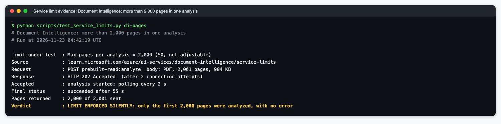

**2. Document Intelligence: 501 MiB file rejected**

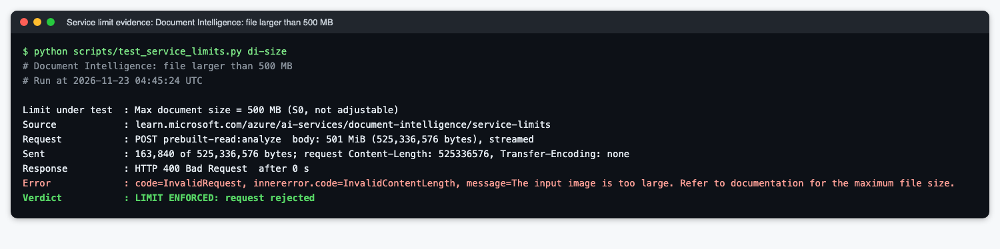

**3. Document Intelligence: rate limit, HTTP 429**

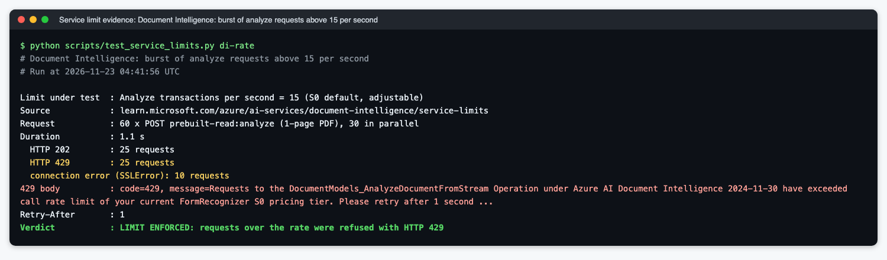

**4. Language: document over 5,120 characters**

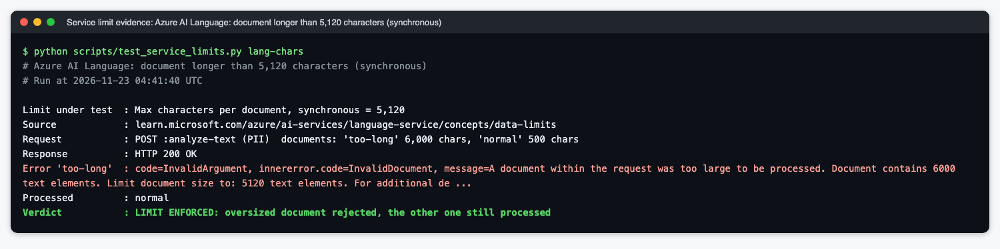

**5. Language: 6 documents in one synchronous request**

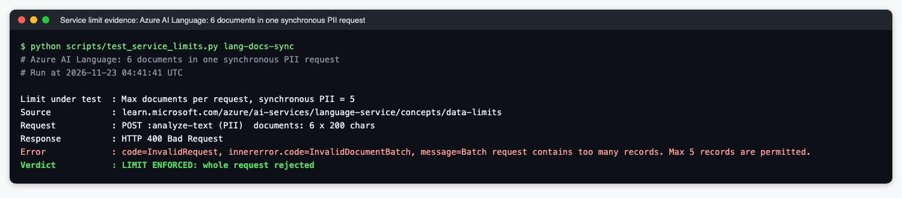

**6. Language: 26 documents in one asynchronous job**

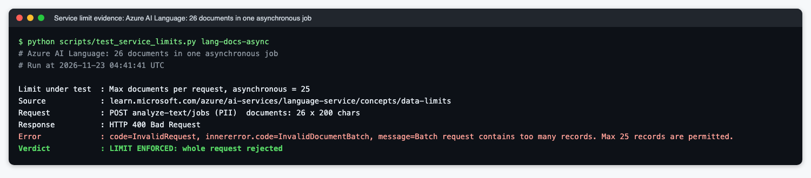

**7. Language: asynchronous job over 125,000 characters**

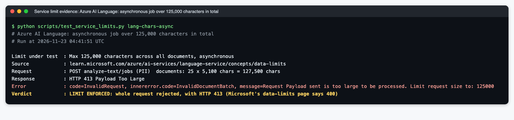

**8. Language: rate limit, HTTP 429**

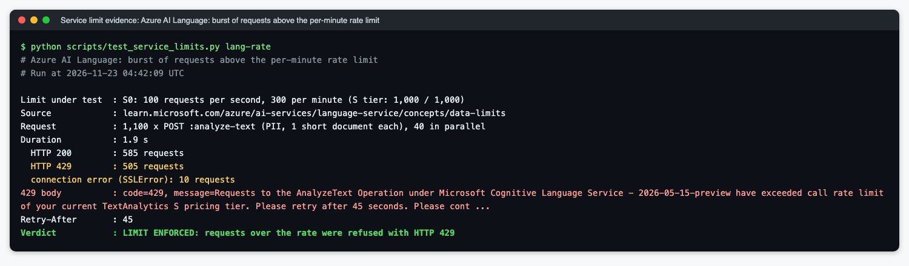

**9. This pipeline: oversized files rejected before any Azure call**

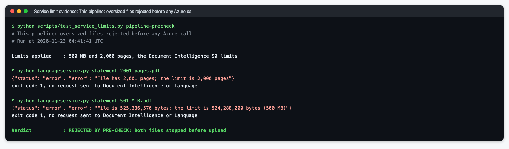

**10. Pipeline results: 500- and 2,000-page batches, mask and block mode**

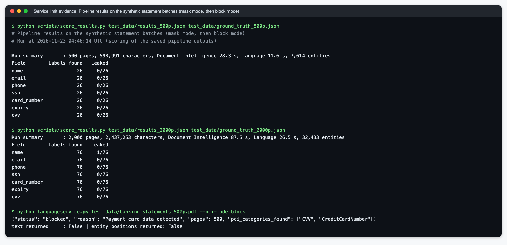

## Known gaps

| Gap | Risk | Suggested fix |
|-----|------|---------------|
| CVV and expiry detection rely on preview features | Preview terms apply, and behavior can change between versions | Keep the rule layer and output check, get compliance sign-off for preview use, and re-run `score_results.py` when the API or model version changes |
| No rule for SSNs or bank account numbers | These depend entirely on the Language service | Add label-anchored rules if your documents use consistent labels |
| Page pre-check covers PDF, TIFF, and single images only | Document Intelligence doesn't reject files over 2,000 pages; it silently analyzes only the first 2,000 (tested). For PPTX, XLS, DOCX, and encrypted or damaged PDFs, the pipeline can't count pages, so it can't detect that truncation either | Count slides for PPTX and worksheets for XLS, estimate DOCX pages from characters, or reject file types whose pages can't be counted |
| About 15% of names printed in capitals are missed | Customer names on statement summary pages stay readable (13 of 84 and 51 of 330 in testing). One mixed-case form name was also missed | Test detection on a title-cased copy of the text, mapped back to the original positions; match names against the customer record; or route documents to human review. Block mode doesn't help, because names aren't card data |
| Heavy over-masking | Transaction reference numbers are masked as phone numbers, and merchant locations as addresses: 22,848 and 8,231 entities on the 2,000-page batch | Filter detections by context (for example, ignore `PhoneNumber` inside a transaction table's reference column), or drop categories you don't need |
| Large files are processed in one Document Intelligence call | A failure means redoing the whole file | Split files over a few hundred pages into page ranges with the `pages` parameter |
| Concurrency is limited per process only | Several workers together can exceed the Language rate limit (300 per minute on S0, 1,000 on S) | Use a shared rate limiter in production. Retries on 429, honoring `Retry-After`, are already in place |
| Overlapping chunks can report an entity twice if the two chunks detect slightly different spans | Duplicate entries in `entities` | Masking is unaffected. Merge overlapping spans if the list needs to be exact |
| Unreliable network path | From the test machine, 17% to 23% of new TLS connections to both services failed in the handshake. `languageservice.py` now retries them: the Document Intelligence SDK retries the upload and every status poll up to 10 times, and Language calls reuse connections and retry up to 8 times. If all retries fail, the job fails closed | Investigate the network path (proxy, VPN, or firewall) before production. In Azure with private endpoints this path is different and should be tested separately. Also retry the whole job a limited number of times, for example through Service Bus redelivery |
| Synchronous command-line tool | Not suitable for large uploads behind a web request | Use the target-state architecture above |
| Keys stored in `.env` | Key leakage | Use Microsoft Entra ID (managed identity) and turn off key authentication on both AI services (`disableLocalAuth=true`) |
| Tested only on English text PDFs | Accuracy on scans, handwriting, and other languages is unknown | Build a labeled test set from your own document layouts |

## Enterprise approach for financial institutions

This section is guidance for banks, card issuers, and payment processors that want to run this kind of pipeline in production. It is not a compliance opinion. Confirm the details with your PCI QSA and your security team.

### 1. Treat the pipeline as part of your cardholder data environment

Any system that receives full card numbers is in PCI DSS scope. That includes the upload storage, the worker, both Azure resources, and their logs. Plan for network isolation, access control, and audit from the start, not as a later hardening step. PCI DSS also prohibits storing sensitive authentication data, including CVVs, after authorization. That makes CVV masking a requirement, not a nice-to-have.

### 2. Process asynchronously

The [target-state architecture](#target-state-architecture) separates intake from processing:

- **Intake returns in seconds.** The caller sends metadata to API Management and gets `202 Accepted` with a job ID and a short-lived upload URL. The file goes straight to Blob Storage, where it's scanned, validated by the Intake Function, and queued.
- **Processing runs in a worker.** In testing, a 500-page text PDF took 34 to 40 seconds and a 2,000-page one about 1.9 minutes. Scanned files take longer. That's too long to hold a web request open.
- **Delivery is by job ID.** The caller polls `GET /jobs/{id}`, honoring `Retry-After`, or receives a webhook.
- **Nothing sensitive is kept.** The original file and extracted text are deleted as soon as the masked result is written, and a storage retention policy removes anything left behind.

### 3. PCI/PII guardrails (defense in depth)

Do not rely on a single detector for card data. Layer the controls in this table:

| Guardrail | In this repo | Why it matters |
|-----------|--------------|----------------|
| Request categories explicitly, including `CVV` and `ExpirationDate` | Yes | Default categories miss CVVs and add heavy over-masking |
| Deterministic rules: Luhn card numbers, labeled CVV and expiry | Yes | Doesn't depend on a model or on preview features |
| Validate the output before returning it | Yes | Blocks any response where a card number or CVV survived |
| Fail closed on any error | Yes | Never returns partly masked text |
| Check Document Intelligence read every page | Yes | It silently stops at 2,000 pages (tested). The pipeline fails if it returned fewer pages than the file has |
| Option to block documents with card data | Yes (`--pci-mode block`) | Removes reliance on catching every card-related field |
| Bind each job to its creator (`oid`) | No (design) | Without it, anyone with a valid token and a guessed job ID could read another caller's result |
| Key authentication turned off on the AI services | No (design) | Leaves no key to leak |
| Overlapping chunks | Yes | A value cut at a chunk boundary is still seen whole |
| Mask regardless of confidence | Yes | Every detected span is masked. Use `confidence_score` to route documents to human review, not to decide whether to mask |
| Never log content | Yes, in code | Log job IDs, page counts, category counts, timings, and versions only. Check that Azure diagnostic settings on both resources follow the same rule |
| Entra ID or Key Vault instead of keys | No | Keys in files and environment variables leak |
| Private endpoints, public network access disabled | No (Azure configuration) | Keeps card data off the public internet |
| Labeled regression test set | Synthetic only | Build one from your real layouts with synthetic values. Track recall per category and re-run on every API or model version change |
| Alert on `rule_only_detections` > 0 | No | Shows when the Language service starts missing values the rules catch |

### 4. Throughput and rate limits

| Service | Limit | Planning guidance |
|---------|-------|-------------------|
| Document Intelligence (S0) | 15 analyze requests per second, 50 get-result requests per second, both adjustable | Retry `429` and honor `Retry-After` (1 second in testing). Poll each request at most once every 2 seconds. A burst of 60 analyze requests got 25 refusals |
| Language (S0) | 100 requests per second, 300 per minute | At 5 chunks of 5,000 characters per request, 300 requests per minute is 7.5 million characters per minute. At the 1,219 characters per page measured here, that's about 6,000 pages per minute across all workers |
| Language (S) | 1,000 requests per second, 1,000 per minute | The tested resource is on S, confirmed by its `429` message. The 2,000-page run used about 235 requests per minute with 5 parallel requests. A burst of 1,100 requests was throttled with `Retry-After: 45` |

- **Parallelism:** 5 parallel Language requests made that stage about 3.5 times faster (24.4 s to 6.9 s on 500 pages). Use a bounded worker pool and a rate limiter shared across workers, so they don't exceed the per-minute limit together.
- **Text density varies.** Measure characters per page on your own documents before using the pages-per-minute estimate.

## File size and page recommendations

| Document | Recommendation |
|----------|----------------|
| Over 500 MB, or over 2,000 pages | Hard limits that can't be raised. Reject at upload, or split the PDF into parts before submitting. Don't rely on Document Intelligence to reject page counts over 2,000: in testing it silently analyzed only the first 2,000 |
| 500 to 2,000 pages | One Document Intelligence call works up to the limit. Measured: a 2,000-page text PDF took 87.5 s in a single call and 114.9 s end to end. To go faster, or to limit how much a failure costs, split into page ranges with the `pages` parameter and run them in parallel. Page-range splitting was not measured here, so benchmark it on your documents |
| Up to 500 pages, text PDF | One Document Intelligence call is fine. Measured: 27.4 to 28.5 s for Document Intelligence and 34 to 40 s end to end for 500 pages |
| Scanned PDFs and images | Expect larger files and longer OCR times than the text PDF measured here. Benchmark with real scans before sizing the deployment |

General rules:

- **Validate before upload.** Check file type, file size, and page count. A rejected upload costs nothing, while a failed analysis wastes time and quota. Size comes from file metadata. Pages have to be counted inside the file, which took about 25 ms for 500 PDF pages and 57 to 99 ms for 2,000. Document Intelligence rejects oversized files itself, but not page counts over 2,000. See [How the size and page checks work](docs/architecture.md#how-the-size-and-page-checks-work).
- **Choose chunk boundaries carefully.** Split Language input at line or paragraph boundaries and overlap chunks, as this pipeline does. Keep the rule layer as a second line of defense.
- **Use the async Language API for bulk jobs if you need fewer requests.** It accepts 25 documents per request, but caps the total at 125,000 characters, which is 25 chunks of 5,000 characters. It rejects the whole request if any document is too large, so validate chunk sizes first.
- **Request only the categories you need.** Each extra general category adds entities to review without protecting more card data.
