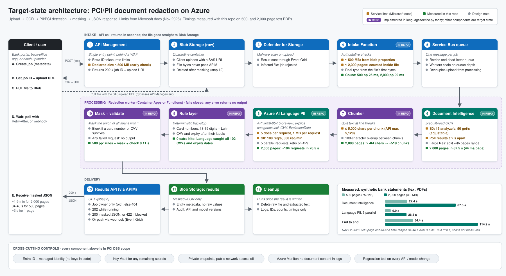

# PCI/PII Document Redaction with Azure Document Intelligence and Azure AI Language

This project takes an uploaded document that contains payment card (PCI) or personal (PII) data and returns JSON with the sensitive values masked. Two Azure services do the work:

1. **Azure AI Document Intelligence** reads the document (including scanned pages) and extracts the text.
2. **Azure AI Language** (PII detection) finds sensitive values in that text.

A deterministic rule layer then catches card numbers, CVVs, and expiry dates the Language service misses. A final check blocks the response if any card number or CVV survives masking.

The response contains only masked text and entity metadata (category, position, length, confidence). The original sensitive values are never returned or logged.

> **Status: prototype.** On synthetic 500- and 2,000-page bank statements, every planted card number, CVV, expiry date, email, phone number, and name was masked (125 cardholder blocks in total). The 2,000-page statement, the Document Intelligence maximum, took about 2.5 minutes end to end. CVV and expiry detection rely on Language API *preview* features. Read [Known gaps](#known-gaps) and [Enterprise approach](#enterprise-approach-for-financial-institutions) before using this with real card data.

## Contents

- [Target-state architecture](#target-state-architecture): logical flow and technical implementation
- [How the pipeline works](#how-the-pipeline-works)
- [Project files](#project-files)
- [Setup and usage](#setup-and-usage)
- [Service limits](#service-limits)
- [Test results](#test-results)
- [Known gaps](#known-gaps)
- [Enterprise approach for financial institutions](#enterprise-approach-for-financial-institutions)
- [File size and page recommendations](#file-size-and-page-recommendations)

## Target-state architecture

Two views of the same design:

| View | Shows | Walkthrough |
|------|-------|-------------|
| Logical flow | The 13 steps from job creation to masked JSON, with limits and measured timings | [docs/architecture.md](docs/architecture.md): sequence diagram, time budgets for 500 and 2,000 pages, failure handling |
| Technical implementation | Each Azure service with official Azure icons: what API Management does, which Function runs which check, identities, and networking | [docs/technical-architecture.md](docs/technical-architecture.md): API Management policies, API contract, managed-identity roles |

In both, the size and page checks and the redaction worker are implemented in `languageservice.py`. The other components are the production design and haven't been deployed.

### Logical flow



### Technical implementation on Azure


## How the pipeline works

```
PDF / image upload
        |
        v
0. Pre-check, before any Azure AI call
   - size from file metadata: reject if over 500 MB
   - real file type from the first bytes, not the extension
   - pages counted inside the file: reject if over 2,000
     (PDF page list, TIFF frames, single images = 1)
   In this repo: precheck() in languageservice.py
   In production: split between API Management and the Intake Function (see below)
        |
        v
1. Azure AI Document Intelligence (prebuilt-read)                  resource: gtadoc
        |  extracted text
        v
2. Split into chunks of up to 5,000 characters, ending at line breaks,
   with 100 characters of overlap between chunks
        |
        v
3. Azure AI Language PII detection, REST API 2026-05-15-preview      resource: gtalangservice
   - explicit category list, including CVV and ExpirationDate
   - 5 chunks per request, 5 requests in parallel
   - retries on HTTP 429 and 5xx (up to 5 attempts), honoring Retry-After
        |
        v
4. Rule layer over the full text
   - 13-19 digit numbers that pass the Luhn check (card numbers)
   - 3-4 digits after CVV / CVC / CVV2 / CID / CSC / Security code
   - month/year after Exp / Expiry / Expiration / Valid thru
        |
        v
5. Mask the union of all detected spans with *
        |
        v
6. Validate: if any Luhn-valid card number or labeled CVV remains, fail
        |
        v
JSON response
```

If the pre-check can't determine the page count, it lets the file through rather than guessing. That covers encrypted or damaged PDFs and Office files. Document Intelligence then enforces its own limit.

#### Where the pre-check runs in production

In production, the client uploads the file straight to Blob Storage with a short-lived upload URL, so API Management never receives the file. The checks are therefore split:

| Check | API Management | Intake Function | Why |
|-------|----------------|-----------------|-----|
| Caller identity, rate limit, quota | Yes | | Decided from the request alone, before anything is stored |
| Size ≤ 500 MB | Early check on the *declared* size | Authoritative check on the *actual* size, from blob properties | The client declares the size to API Management and could lie; the blob's size can't be faked |
| File type | Early check on the *declared* type | Authoritative check from the file's first bytes | Same reason |
| Pages ≤ 2,000 | No | Yes, counted inside the file | API Management never sees the file, and its policies can't parse PDF or TIFF structure |
| Malware | No | No: Defender for Storage scans first, and its clean result triggers the Intake Function | |

`precheck()` in `languageservice.py` is the Intake Function's logic. API Management's checks are configuration (policies), shown in [docs/technical-architecture.md](docs/technical-architecture.md#what-api-management-does). More detail: [How the size and page checks work](docs/architecture.md#how-the-size-and-page-checks-work).

The pipeline **fails closed**. If any Language request fails, any chunk returns an error, or the final check finds a surviving card number or CVV, it returns `{"status": "error"}` and no text at all. The error message never includes document content.

### Categories requested

| Group | Categories |
|-------|------------|
| Payment card | `CreditCardNumber`, `CVV` (preview), `ExpirationDate` (preview) |
| Bank and tax | `USBankAccountNumber`, `BankAccountNumber` (preview), `ABARoutingNumber`, `SWIFTCode`, `InternationalBankingAccountNumber`, `USSocialSecurityNumber`, `USIndividualTaxpayerIdentification` |
| Personal | `Person`, `Email`, `PhoneNumber`, `Address`, `DateOfBirth` (preview) |

To change the list, edit `PII_CATEGORIES` in `languageservice.py`.

General categories such as `Organization` and `DateTime` are left out on purpose. On transaction-heavy documents they mask merchant names and every transaction date, which buries the sensitive values. The service sometimes still labels an expiry date as `DateTime`; that entity is masked like any other.

### Why the REST API instead of the SDK

The `azure-ai-textanalytics` SDK (5.4.0, the latest release) supports Language API versions up to `2023-04-01`. That version has no `CVV` or `ExpirationDate` category. The pipeline calls the REST API directly so it can use `2026-05-15-preview`.

## Project files

| File | Purpose |
|------|---------|
| `languageservice.py` | The pipeline. Run it on a file, or import `process_document(path)` |
| `scripts/generate_banking_pdf.py` | Generates a synthetic bank statement PDF (500 pages by default, any size with `--pages`) and a ground-truth file listing every planted value |
| `scripts/score_results.py` | Scores pipeline output against the ground truth |
| `scripts/benchmark.py` | Times each stage, and compares 1 worker with N parallel workers for Language calls |
| `scripts/test_precheck.py` | Tests the size and page-count pre-check offline, including PDFs and TIFFs at and over the 2,000-page limit |
| `scripts/probe_pii_categories.py` | Calls the Language REST API to compare what each API version detects |
| `scripts/render_architecture.py` | Generates `docs/architecture.svg` (logical flow) |
| `scripts/render_technical_architecture.py` | Generates `docs/technical-architecture.svg` (technical implementation, with Azure icons) |
| `docs/architecture.md` | Logical flow, step by step |
| `docs/technical-architecture.md` | Technical implementation: services, API Management policies, API contract, identities |
| `docs/icons/azure/` | Official Azure architecture icons used in the technical diagram, with Microsoft's terms of use |
| `sample_pci_test.pdf` | One-page test form with public test card numbers and sample CVVs. Not real accounts |
| `requirements.txt` | Pinned dependencies |
| `test_data/` | Synthetic test statements (500 and 2,000 pages), their ground-truth files, and pipeline output. See [Test documents](#test-documents) |
| `.env` | Endpoints and keys. Not committed |

## Setup and usage

1. Create `.env` in the project root:

   ```
   AZURE_DOCINTEL_ENDPOINT=https://gtadoc.cognitiveservices.azure.com/
   AZURE_DOCINTEL_KEY=<Document Intelligence key>
   AZURE_LANGUAGE_ENDPOINT=https://gtalangservice.cognitiveservices.azure.com/
   AZURE_LANGUAGE_KEY=<Language key>
   ```

   Each key must belong to the resource at the matching endpoint. A Document Intelligence key does not work against the Language API. The mismatch returns `401 Access denied due to invalid subscription key or wrong API endpoint`.

2. Install dependencies:

   ```
   pip install -r requirements.txt
   ```

3. Run the pipeline:

   ```
   python languageservice.py sample_pci_test.pdf
   ```

   The exit code is 0 on success and 1 on a pipeline error.

4. Optional: reproduce the tests. The test documents are already in `test_data/`:

   ```
   python languageservice.py test_data/banking_statements_500p.pdf > test_data/results_500p.json
   python scripts/score_results.py test_data/results_500p.json test_data/ground_truth_500p.json
   python languageservice.py test_data/banking_statements_2000p.pdf > test_data/results_2000p.json
   python scripts/score_results.py test_data/results_2000p.json test_data/ground_truth_2000p.json
   python scripts/benchmark.py test_data/banking_statements_500p.pdf
   python scripts/test_precheck.py
   ```

   To regenerate the documents (output is identical each time):

   ```
   python scripts/generate_banking_pdf.py                # 500 pages
   python scripts/generate_banking_pdf.py --pages 2000   # 2,000 pages
   ```

### Example output (`sample_pci_test.pdf`, entities shortened)

```json
{
  "status": "ok",
  "source_file": "sample_pci_test.pdf",
  "file_type": "pdf",
  "size_bytes": 1973,
  "pages": 1,
  "characters": 430,
  "language_api_version": "2026-05-15-preview",
  "language_model_versions": ["2026-05-01"],
  "timings": {"precheck_s": 0.037, "document_intelligence_s": 2.5, "language_s": 0.3},
  "pii_detected": true,
  "category_counts": {"Address": 1, "CVV": 2, "CreditCardNumber": 2, "DateTime": 2, "Email": 1, "Person": 2, "PhoneNumber": 1},
  "rule_only_detections": 0,
  "entity_count": 11,
  "entities": [
    {"category": "CreditCardNumber", "source": "language", "confidence_score": 1.0, "offset": 225, "length": 19, "masked_value": "*******************"}
  ],
  "masked_text": "PAYMENT CARD AUTHORIZATION FORM (TEST DATA ONLY)\nCustomer Name: *********** ... Card Number: ******************* Expiration Date: ***** CVV: *** ..."
}
```

| Field | Meaning |
|-------|---------|
| `source` | `language` (found by Azure AI Language) or `rule` (found only by the rule layer) |
| `rule_only_detections` | Values only the rule layer caught. A non-zero count means the Language service missed something, so track it over time |
| `language_api_version`, `language_model_versions` | Recorded for audit |
| `file_type`, `size_bytes` | From the pre-check. The type is detected from the file's first bytes |
| `timings` | Seconds spent in the pre-check, Document Intelligence, and Language |

## Service limits

All limits are for the Standard tiers (Document Intelligence S0; Language S0 and S). They were checked against Microsoft's documentation in November 2026. Limits change, so re-check the linked pages before you design around them.

### Document Intelligence, Read model (S0)

Source: [Document Intelligence service quotas and limits](https://learn.microsoft.com/en-us/azure/ai-services/document-intelligence/service-limits)

| Limit | Value | Adjustable |
|-------|-------|------------|
| Max document size | 500 MB | No |
| Max pages per analysis | 2,000 | No |
| Analyze requests (POST) per second | 15 | Yes, by support request |
| Get-result requests (GET) per second | 50 | Yes, by support request |
| Max OCR JSON response | 500 MB | No |
| Recommended polling interval | At most once every 2 seconds per request | n/a |

- Billing is per page. For PDF and TIFF, each page counts as one page.
- The `pages` parameter (for example `"1-100"`) analyzes a page range instead of the whole file.
- Supported file types for Read: PDF, JPEG, PNG, BMP, TIFF, HEIF, DOCX, PPTX, XLS.

### Azure AI Language, PII detection

Source: [Language service data limits](https://learn.microsoft.com/en-us/azure/ai-services/language-service/concepts/data-limits)

| Limit | Value |
|-------|-------|
| Characters per document, synchronous API | 5,120 (measured in text elements) |
| Documents per request, synchronous API | 5 |
| Documents per request, asynchronous API | 25, with a total of 125,000 characters across all documents |
| Max request size | 1 MB |
| Rate limit, S0 tier | 100 requests per second, 300 per minute |
| Rate limit, S tier | 1,000 requests per second, 1,000 per minute |
| Billing unit | 1 text record = 1,000 characters (billing only, not a cap) |

What happens when a limit is exceeded:

- **Synchronous:** an oversized document gets an invalid-document error, and the other documents in the request are still processed.
- **Asynchronous:** the whole request is rejected with `400 Bad Request`.

The pipeline uses 5,000-character chunks and 5 chunks per request (at most about 25,000 characters, well under 1 MB), which stays inside the synchronous limits.

### API versions

Source: [PII entity categories](https://learn.microsoft.com/en-us/azure/ai-services/language-service/personally-identifiable-information/concepts/entity-categories)

| API | Version | Notes |
|-----|---------|-------|
| Language, used by this pipeline | `2026-05-15-preview` | Required for `CVV`, `ExpirationDate`, `BankAccountNumber`, and `DateOfBirth`. Subject to Microsoft's preview terms |
| Language, current GA | `2026-05-01` | Does not detect CVVs (tested, see below) |
| Document Intelligence SDK | `azure-ai-documentintelligence` 1.0.2 | |

## Test results

All tests ran on November 22, 2026, against the `gtadoc` (Document Intelligence) and `gtalangservice` (Language) resources, from a single laptop. Where a measurement was repeated, the range across runs is shown. Otherwise the figure comes from one run, so expect variation between runs and regions.

### Test documents

Both statements are committed in `test_data/` and were generated by `scripts/generate_banking_pdf.py`. All content is synthetic: card numbers are public test numbers (Visa, Mastercard, American Express, Discover), names and accounts are fake, and SSNs use the never-issued `000` area number.

| Property | `banking_statements_500p.pdf` | `banking_statements_2000p.pdf` |
|----------|-------------------------------|--------------------------------|
| Pages | 500 | 2,000 (the Document Intelligence maximum) |
| File size | 861 KB | 3.4 MB |
| Format | Text PDF, not a scan | Text PDF, not a scan |
| Content per page | Account header and an 18-row transaction table | Same |
| Cardholder blocks | 25, one every 20th page | 100, one every 20th page |
| Fields per block | Name, email, phone, SSN, card type, card number, expiry, CVV | Same |
| Ground truth | `ground_truth_500p.json` | `ground_truth_2000p.json` |
| Pipeline output | `results_500p.json` | `results_2000p.json` |
| Extracted text | 528,527 characters (about 1,057 per page) | 2,116,719 characters (about 1,058 per page) |

### Detection accuracy

Scored with `scripts/score_results.py`. For each label, the scorer reads the value after the label in the masked output and counts a leak if it matches a planted value exactly.

| Planted value | Leaked, 500 pages | Leaked, 2,000 pages | Detected by |
|---------------|-------------------|---------------------|-------------|
| Card number | 0 / 25 | 0 / 100 | Language (`CreditCardNumber`) |
| CVV | 0 / 25 | 0 / 100 | Language (`CVV`) |
| Expiry date | 0 / 25 | 0 / 100 | Language (`DateTime`) |
| Email | 0 / 25 | 0 / 100 | Language (`Email`) |
| Phone | 0 / 25 | 0 / 100 | Language (`PhoneNumber`) |
| Cardholder name | 0 / 25 | 0 / 100 | Language (`Person`) |
| SSN | 25 / 25 | 100 / 100 | Not detected. Test-data artifact, see below |

- **SSN result.** The generator uses SSNs with a `000` area number, which is never issued, so the detector correctly ignores them. `scripts/probe_pii_categories.py` confirmed that a valid-format test SSN (`123-45-6789`) is detected and masked. To test SSN detection on your own data, use valid-format synthetic values.
- **Rule layer.** The Language service caught every card number, CVV, and expiry date on its own, so the rule layer added nothing on either document (`rule_only_detections: 0`). It is there as a backstop for layouts the service handles less well.

All entities returned:

| Category | 500 pages | 2,000 pages | Notes |
|----------|-----------|-------------|-------|
| `BankAccountNumber` | 500 | 2,000 | The account number in each page header |
| `PhoneNumber` | 41 | 139 | 25 and 100 planted; other phone-like numbers were also masked |
| `Person` | 28 | 105 | 25 and 100 planted names |
| `CreditCardNumber` | 25 | 100 | |
| `CVV` | 25 | 100 | |
| `DateTime` | 25 | 104 | Expiry dates, plus 4 other dates at 2,000 pages |
| `Email` | 25 | 100 | |
| **Total** | **669** | **2,648** | |

### Processing time

Measured with `scripts/benchmark.py` (1 page and 500 pages) and `python languageservice.py` (500 and 2,000 pages):

| Stage | 1-page form (2 KB) | 500-page statement (861 KB) | 2,000-page statement (3.4 MB) |
|-------|--------------------|-----------------------------|-------------------------------|
| Characters extracted | 430 | 528,527 | 2,116,719 |
| Chunks / Language requests | 1 / 1 | 109 / 22 | about 434 / 87 |
| Size and page pre-check | 37 ms | 62 ms | 141 ms |
| Document Intelligence | 2.5 s | 28.9 to 44.7 s (58 to 89 ms per page, 2 runs) | 108.8 s (54 ms per page) |
| Language PII, 5 parallel requests | 0.3 s | 9.2 to 10.2 s (2 runs) | 36.7 s |
| Language PII, 1 request at a time | 0.3 s | 40.0 s | Not measured |
| Rules, masking, validation | under 0.01 s | 0.09 s | Not timed separately |
| **End to end** | **2.8 s** | **39.2 to 54.0 s (2 runs)** | **146.1 s, about 2.5 minutes (wall clock)** |

| Observation | Detail |
|-------------|--------|
| Document Intelligence dominates | It took 108.8 of the 146.1 seconds at 2,000 pages, about three quarters of the total |
| Document Intelligence time varies | Two runs of the same 500-page file on the same resource took 28.9 s and 44.7 s. The slower run took about 1.5 times as long, so leave headroom in any time budget |
| Time scales roughly linearly | 4 times the pages took about 3.8 times the Document Intelligence time (against the faster 500-page run) and 3.6 times the Language time |
| Parallel Language calls matter | The same 22 requests took 40.0 s one at a time and 10.2 s with 5 in parallel, about 4 times faster |
| Language stays inside the S0 rate limit | 87 requests in 36.7 s is about 142 requests per minute, under the 300-per-minute S0 limit |
| Rules and validation are cheap | 0.09 s for 500 pages |
| The page pre-check is cheap | Inside pipeline runs it took 37 to 141 ms, including loading the PDF library. On its own it takes 24 to 26 ms for 500 pages and 57 to 99 ms for 2,000. See [Size and page pre-check](#size-and-page-pre-check) |
| Transient connection errors happen | The first 2,000-page attempt failed before uploading, with a dropped TLS connection. The pipeline returned an error, and an immediate retry succeeded. See [Known gaps](#known-gaps) |

These numbers are for text PDFs. Scanned PDFs need full OCR and are usually much larger files, so expect them to be slower. They were not measured here. Test with your own scanned samples before you size anything.

### Size and page pre-check

Tested with `scripts/test_precheck.py`, which runs offline and makes no Azure calls. It checks the three committed test documents, and generates edge cases right at and just over the limits: blank-page PDFs and multi-frame TIFFs at 2,000 and 2,001 pages, plus files the pre-check can't count.

| File | Size | Type detected | Pages counted | Expected | Result | Check time |
|------|------|---------------|---------------|----------|--------|------------|
| 1-page form (`sample_pci_test.pdf`) | 2 KB | PDF | 1 | Pass | Pass | 5 ms |
| 500-page bank statement | 861 KB | PDF | 500 | Pass | Pass | 24 ms |
| 2,000-page bank statement (at the limit) | 3.4 MB | PDF | 2,000 | Pass | Pass | 99 ms |
| PDF, 2,000 blank pages (at the limit) | 244 KB | PDF | 2,000 | Pass | Pass | 57 ms |
| PDF, 2,001 blank pages (over the limit) | 244 KB | PDF | 2,001 | Reject | Reject | 57 ms |
| TIFF, 3 frames | under 1 KB | TIFF | 3 | Pass | Pass | 1 ms |
| TIFF, 2,001 frames (over the limit) | 250 KB | TIFF | 2,001 | Reject | Reject | 86 ms |
| PNG image | under 1 KB | PNG | 1 | Pass | Pass | 1 ms |
| Damaged PDF | under 1 KB | PDF | Can't be read | Pass to Document Intelligence | Pass | 1 ms |
| Text file | under 1 KB | Other | Not counted | Pass to Document Intelligence | Pass | under 1 ms |

All 10 cases behaved as expected, and timings were consistent across repeated runs.

- **Rejections happen before any service call.** Running `python languageservice.py` on the 2,001-page PDF returns `{"status": "error", "error": "File has 2,001 pages; the limit is 2,000 pages"}` with exit code 1, without calling Azure.
- **Cost grows with page count and file size.** At 2,000 pages, the blank 244 KB PDF took 57 ms and the 3.4 MB statement took 99 ms. Even at the 2,000-page limit, the pre-check takes about a tenth of a second.
- **Files at the limit go through end to end.** The 2,000-page statement passed the pre-check and then completed the full pipeline in 146.1 s, with nothing leaked. See [Processing time](#processing-time) and [Detection accuracy](#detection-accuracy).

### API version comparison

`scripts/probe_pii_categories.py` sent `Card number: 4111 1111 1111 1111. Expiration: 04/28. CVV: 123.` to the Language REST API:

| API version | Card number | Expiry `04/28` | CVV `123` |
|-------------|-------------|----------------|-----------|
| `2026-05-01` GA, default categories | Masked | Masked (as `DateTime`) | **Not masked** |
| `2026-05-15-preview`, explicit categories including `CVV` | Masked | Masked (as `DateTime`) | Masked (as `CVV`) |

This is why the pipeline uses the preview API with an explicit category list.

## Known gaps

| Gap | Risk | Suggested fix |
|-----|------|---------------|
| CVV and expiry detection rely on preview features | Preview terms apply, and behavior can change between versions | Keep the rule layer and output check, get compliance sign-off for preview use, and re-run `score_results.py` when the API or model version changes |
| No rule for SSNs or bank account numbers | These depend entirely on the Language service | Add label-anchored rules if your documents use consistent labels |
| Page pre-check covers PDF, TIFF, and single images only | PPTX, XLS, DOCX, and encrypted or damaged PDFs reach Document Intelligence without a page check, and fail there if they're too large | Count slides for PPTX and worksheets for XLS. Estimate DOCX pages from characters |
| Large files are processed in one Document Intelligence call | A failure means redoing the whole file | Split files over a few hundred pages into page ranges with the `pages` parameter |
| Concurrency is limited per process only | Several workers together can exceed Language's 300 requests-per-minute limit on S0 | Use a shared rate limiter in production. Retries on 429 are already in place |
| Overlapping chunks can report an entity twice if the two chunks detect slightly different spans | Duplicate entries in `entities` | Masking is unaffected. Merge overlapping spans if the list needs to be exact |
| Transient connection errors fail the job | Seen once in testing: a dropped TLS connection before the 2,000-page upload. The pipeline returned an error rather than partial output, and an immediate retry succeeded | Retry the whole job a limited number of times, for example through Service Bus redelivery, before reporting failure |
| Synchronous command-line tool | Not suitable for large uploads behind a web request | Use the target-state architecture above |
| Keys stored in `.env` | Key leakage | Use Microsoft Entra ID (managed identity) or Key Vault in production |
| Tested only on English text PDFs | Accuracy on scans, handwriting, and other languages is unknown | Build a labeled test set from your own document layouts |

## Enterprise approach for financial institutions

This section is guidance for banks, card issuers, and payment processors that want to run this kind of pipeline in production. It is not a compliance opinion. Confirm the details with your PCI QSA and your security team.

### 1. Treat the pipeline as part of your cardholder data environment

Any system that receives full card numbers is in PCI DSS scope. That includes the upload storage, the worker, both Azure resources, and their logs. Plan for network isolation, access control, and audit from the start, not as a later hardening step. PCI DSS also prohibits storing sensitive authentication data, including CVVs, after authorization. That makes CVV masking a requirement, not a nice-to-have.

### 2. Process asynchronously

The [target-state architecture](#target-state-architecture) separates intake from processing:

- **Intake returns in seconds.** The caller sends metadata to API Management and gets `202 Accepted` with a job ID and a short-lived upload URL. The file goes straight to Blob Storage, where it's scanned, validated by the Intake Function, and queued.
- **Processing runs in a worker.** In testing, a 500-page text PDF took 39 to 54 seconds and a 2,000-page one about 2.5 minutes. Scanned files take longer. That's too long to hold a web request open.
- **Delivery is by job ID.** The caller polls `GET /jobs/{id}`, honoring `Retry-After`, or receives a webhook.
- **Nothing sensitive is kept.** The original file and extracted text are deleted as soon as the masked result is written, and a storage retention policy removes anything left behind.

### 3. PCI/PII guardrails (defense in depth)

Do not rely on a single detector for card data. Layer the controls in this table:

| Guardrail | In this repo | Why it matters |
|-----------|--------------|----------------|
| Request categories explicitly, including `CVV` and `ExpirationDate` | Yes | Default categories miss CVVs and add heavy over-masking |
| Deterministic rules: Luhn card numbers, labeled CVV and expiry | Yes | Doesn't depend on a model or on preview features |
| Validate the output before returning it | Yes | Blocks any response where a card number or CVV survived |
| Fail closed on any error | Yes | Never returns partly masked text |
| Overlapping chunks | Yes | A value cut at a chunk boundary is still seen whole |
| Mask regardless of confidence | Yes | Every detected span is masked. Use `confidence_score` to route documents to human review, not to decide whether to mask |
| Never log content | Yes, in code | Log job IDs, page counts, category counts, timings, and versions only. Check that Azure diagnostic settings on both resources follow the same rule |
| Entra ID or Key Vault instead of keys | No | Keys in files and environment variables leak |
| Private endpoints, public network access disabled | No (Azure configuration) | Keeps card data off the public internet |
| Labeled regression test set | Synthetic only | Build one from your real layouts with synthetic values. Track recall per category and re-run on every API or model version change |
| Alert on `rule_only_detections` > 0 | No | Shows when the Language service starts missing values the rules catch |

### 4. Throughput and rate limits

| Service | Limit | Planning guidance |
|---------|-------|-------------------|
| Document Intelligence (S0) | 15 analyze requests per second, 50 get-result requests per second, both adjustable | Retry `429` with exponential backoff and honor `Retry-After`. Poll each request at most once every 2 seconds |
| Language (S0) | 100 requests per second, 300 per minute | At 5 chunks of 5,000 characters per request, 300 requests per minute is 7.5 million characters per minute. At the 1,057 characters per page measured here, that's about 7,000 pages per minute across all workers. Measured: the 2,000-page run used about 142 requests per minute with 5 parallel requests |
| Language (S) | 1,000 requests per second, 1,000 per minute | Check your resource's pricing tier before sizing |

- **Parallelism:** 5 parallel Language requests made that stage about 4 times faster (40.0 s to 10.2 s on 500 pages). Use a bounded worker pool and a rate limiter shared across workers, so they don't exceed the per-minute limit together.
- **Text density varies.** Measure characters per page on your own documents before using the pages-per-minute estimate.

## File size and page recommendations

| Document | Recommendation |
|----------|----------------|
| Over 500 MB, or over 2,000 pages | Hard limits that can't be raised. Reject at upload, or split the PDF into parts before submitting |
| 500 to 2,000 pages | One Document Intelligence call works up to the limit. Measured: a 2,000-page text PDF took 108.8 s in a single call and 146.1 s end to end. To go faster, or to limit how much a failure costs, split into page ranges with the `pages` parameter and run them in parallel. Page-range splitting was not measured here, so benchmark it on your documents |
| Up to 500 pages, text PDF | One Document Intelligence call is fine. Measured: 28.9 to 44.7 s for Document Intelligence and 39 to 54 s end to end for 500 pages |
| Scanned PDFs and images | Expect larger files and longer OCR times than the text PDF measured here. Benchmark with real scans before sizing the deployment |

General rules:

- **Validate before upload.** Check file type, file size, and page count. A rejected upload costs nothing, while a failed analysis wastes time and quota. Size comes from file metadata. Pages have to be counted inside the file, which took about 25 ms for 500 PDF pages and 57 to 99 ms for 2,000. See [How the size and page checks work](docs/architecture.md#how-the-size-and-page-checks-work).
- **Choose chunk boundaries carefully.** Split Language input at line or paragraph boundaries and overlap chunks, as this pipeline does. Keep the rule layer as a second line of defense.
- **Use the async Language API for bulk jobs if you need fewer requests.** It accepts 25 documents per request, but caps the total at 125,000 characters, which is 25 chunks of 5,000 characters. It rejects the whole request if any document is too large, so validate chunk sizes first.
- **Request only the categories you need.** Each extra general category adds entities to review without protecting more card data.
