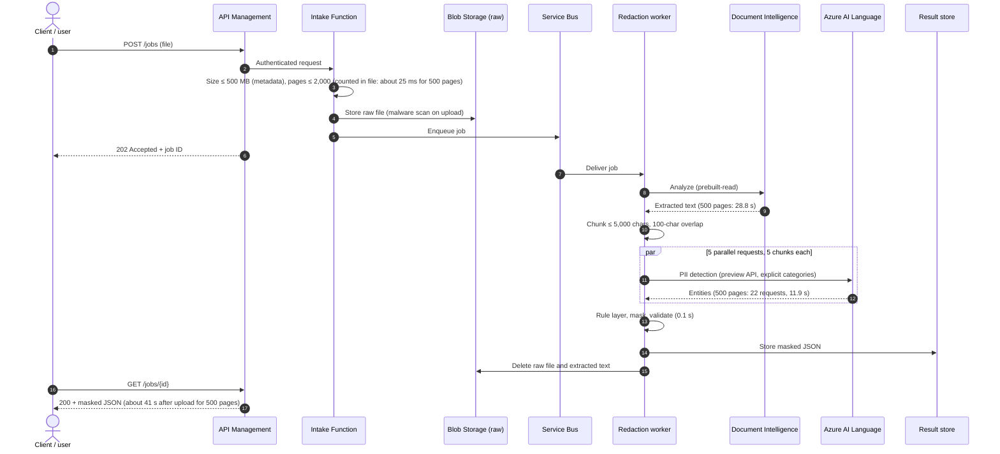

# Target-state architecture: PCI/PII document redaction on Azure

This page explains the end-to-end flow, from a user uploading a document to that user receiving masked JSON. The size and page checks from step 2, and steps 6 to 10, are implemented in [`languageservice.py`](../languageservice.py) today. The other steps describe the target production design.

The diagram is generated by [`scripts/render_architecture.py`](../scripts/render_architecture.py). Edit the script and re-run it rather than editing the SVG by hand.

- **Limits** come from Microsoft's documentation, checked in November 2026: [Document Intelligence limits](https://learn.microsoft.com/en-us/azure/ai-services/document-intelligence/service-limits) and [Language data limits](https://learn.microsoft.com/en-us/azure/ai-services/language-service/concepts/data-limits).
- **Timings** were measured with this repo on a synthetic 500-page text PDF (861 KB), in a single run against East US resources.

## The flow in one paragraph

1. The user uploads a file and immediately gets a job ID back.
2. The file is validated, stored in a locked-down container, scanned for malware, and queued.
3. A worker picks up the job:
   - Document Intelligence turns the file into text.
   - The text is split into chunks the Language service can accept.
   - The Language service and a set of deterministic rules find every sensitive value.
   - Those values are masked, and a final check confirms no card number or CVV survived.
4. The masked JSON is stored, the original file and extracted text are deleted, and the user collects the result with the job ID.

If anything goes wrong in the worker, the job fails, and no partially masked text is ever returned.

## Sequence

## Step by step

### Intake (synchronous, returns in seconds)

| Step | Component | What it does | Limits and numbers |
|------|-----------|--------------|--------------------|
| 1 | **API Management** | Single entry point. Authenticates the caller with Microsoft Entra ID, applies WAF rules, and returns `202 Accepted` with a job ID as soon as the file is accepted | No document processing happens here, so the response is fast regardless of file size |
| 2 | **Intake Function** | Rejects files that would fail later: wrong type, too large, too many pages. See [How the size and page checks work](#how-the-size-and-page-checks-work) | Max 500 MB and 2,000 pages per document. Both are hard limits for Document Intelligence S0 and can't be raised. **Measured (three runs):** counting pages took 24 to 26 ms for the 500-page statement, and 57 to 99 ms for 2,000-page PDFs depending on file size (99 ms for the 3.4 MB statement). A 2,001-page PDF is rejected with no Azure call |
| 3 | **Blob Storage (raw)** | Holds the original file in a quarantine container | Private endpoint only, encrypted at rest. The file is deleted in step 12, and a lifecycle rule removes anything left behind |
| 4 | **Defender for Storage** | Scans the upload for malware | An infected file rejects the job before any processing |
| 5 | **Service Bus queue** | One message per job | Separates upload from processing, so a slow 500-page job never blocks an upload request. Gives retries and a dead-letter queue |

#### How the size and page checks work

The two limits are checked differently, because only one of them is visible from outside the file:

- **Size (500 MB)** is known without opening the file. Read it from the upload's `Content-Length` header, or from the blob's properties once it's stored.
- **Pages (2,000)** are not in any header. The Intake Function opens the file and counts them, without rendering anything.

The file type is detected from the file's first bytes, not from its extension, so a renamed file can't skip the check.

| File type | How pages are counted | Implemented in `languageservice.py` |
|-----------|-----------------------|-------------------------------------|
| PDF | Length of the PDF's internal page list, read with `pypdf` | Yes |
| TIFF | Number of image frames, read with Pillow | Yes |
| JPEG, PNG, BMP, HEIF | Always 1 page | Yes |
| PPTX | Number of slides in the file. Microsoft counts each slide as one page | No |
| XLS | Number of worksheets. Microsoft counts each worksheet as one page | No |
| DOCX | No reliable page count is stored in the file. Microsoft's billing docs count Word documents in blocks of 3,000 characters, so a character count gives an estimate. Not confirmed to be how the 2,000-page limit is applied | No |

When the count can't be determined, the pre-check doesn't reject the file. That covers encrypted or damaged PDFs and the unimplemented types. Document Intelligence still enforces its own limits in step 6, and the pipeline returns its error as `{"status": "error"}`. The pre-check exists to reject oversized files early and cheaply, not to replace the service's own validation.

**Large uploads.** Files near the 500 MB limit are better uploaded directly to Blob Storage with a short-lived, write-only upload URL (a SAS token) than through the API request body. In that variant, the Intake Function runs when the blob arrives, reads the size from the blob's properties, counts pages from the stored file, and deletes the blob if either limit is exceeded.

### Processing (asynchronous, inside the redaction worker)

The worker runs on Azure Container Apps or Azure Functions and scales with queue depth. It **fails closed**: any error ends the job with no output.

| Step | Component | What it does | Limits and numbers |
|------|-----------|--------------|--------------------|
| 6 | **Document Intelligence** (`prebuilt-read`) | Runs OCR and returns all text in the file | **Limits:** 15 analyze requests per second and 50 get-result requests per second by default on S0 (both adjustable). Microsoft recommends polling for results no more than once every 2 seconds. **Measured:** 500 pages in 28.8 s (58 ms per page). **Large files:** split into page ranges with the `pages` parameter so a failure only retries one range |
| 7 | **Chunker** | Splits the text at line breaks so the Language service can accept it | **Limits:** the Language sync API takes at most 5,120 characters per document, so chunks are capped at 5,000. Consecutive chunks overlap by 100 characters so a value cut at a boundary is still seen whole. **Measured:** 528,527 characters became 109 chunks |
| 8 | **Azure AI Language, PII detection** | Finds sensitive values. Uses API `2026-05-15-preview` with an explicit category list that includes `CreditCardNumber`, `CVV`, `ExpirationDate`, bank and tax IDs, and personal data | **Limits:** 5 documents and 1 MB per request. S0 allows 100 requests per second and 300 per minute. **This design:** 5 chunks per request, 5 requests in parallel, retry on `429` honoring `Retry-After`. **Measured:** 22 requests in 11.9 s, against 47.4 s one at a time |
| 9 | **Rule layer** | Deterministic backstop that doesn't depend on a model: card numbers (13 to 19 digits that pass the Luhn check), and CVVs and expiry dates that follow their labels | **Measured:** 0 extra hits on the test set, because the Language service caught all 25 CVVs and expiry dates. The rules guard against layouts the service handles less well |
| 10 | **Mask + validate** | Masks the union of every span from steps 8 and 9 with `*`, then re-checks the masked text | Blocks the job if any card number or labeled CVV survives. **Measured:** steps 9 and 10 together take 0.1 s for 500 pages |

### Delivery

| Step | Component | What it does | Limits and numbers |
|------|-----------|--------------|--------------------|
| 11 | **Result store** | Stores the masked JSON: masked text, entity categories, positions, confidence, and the API and model versions used | Never stores raw values |
| 12 | **Cleanup** | Deletes the raw file and the extracted text once the result is written | Logs contain only job IDs, counts, timings, and versions |
| 13 | **Results API** (through API Management) | `GET /jobs/{id}` returns `202` while the job runs and `200` with the masked JSON when it's done. Alternatively, push a webhook through Event Grid | **Measured end to end:** about 41 s for the 500-page file and about 3 s for a 1-page form |

### Cross-cutting controls

Every component above handles card data or its derivatives, so all of them are in PCI DSS scope:

- **Identity:** Microsoft Entra ID and managed identities between services, with no keys in code. Key Vault for any secrets that remain.
- **Network:** private endpoints for Blob Storage, Service Bus, Document Intelligence, and Language, with public network access turned off.
- **Logging:** Azure Monitor receives job IDs, page counts, entity counts by category, timings, and versions. Document text and entity values are never logged, including in the services' diagnostic settings.
- **Regression testing:** a labeled test set (like `scripts/generate_banking_pdf.py` plus `scripts/score_results.py`) re-run whenever the Language API or model version changes. CVV and expiry detection rely on preview features that can change.

## Time budget for a 500-page document

| Stage | Time | Share |
|-------|------|-------|
| Size and page check (2) | 24 to 26 ms | under 0.1% |
| Upload, storage, malware scan, queue (1, 3 to 5) | Not measured. Expect seconds, dominated by upload bandwidth | |
| Document Intelligence (6) | 28.8 s | 71% |
| Chunking (7) | Not timed separately. It's string slicing in memory and is negligible next to the network calls | |
| Language PII, 5 parallel (8) | 11.9 s | 29% |
| Rules, masking, validation (9, 10) | 0.1 s | under 1% |
| **Processing total** | **40.8 s** | |

Document Intelligence dominates once Language calls run in parallel. To go faster on very large files, split them into page ranges and run those Document Intelligence calls in parallel, within the 15 requests-per-second limit. This wasn't measured here, so benchmark it on your own documents. Scanned PDFs need full OCR and will be slower than the text PDF measured here.

## What happens when something fails

| Failure | Where | Outcome |
|---------|-------|---------|
| File over 500 MB or 2,000 pages, or an unsupported type | Step 2 | Rejected at upload with a clear error, for example `File has 2,001 pages; the limit is 2,000 pages`. Nothing is stored and no Azure AI service is called |
| Page count can't be read (encrypted or damaged PDF, or a type the pre-check doesn't count) | Step 2, then step 6 | The pre-check lets the file through, and Document Intelligence enforces the limit. Its error is returned as `{"status": "error"}` |
| Malware detected | Step 4 | Job rejected, file quarantined |
| Document Intelligence error | Step 6 | Job fails. Service Bus retries, then moves the message to the dead-letter queue |
| Language returns `429` or `5xx` | Step 8 | Retried with backoff, honoring `Retry-After`. Fails the job after 5 attempts |
| Language returns an error for any chunk | Step 8 | Job fails. A document is never returned with some chunks unmasked |
| A card number or CVV survives masking | Step 10 | Job fails and an alert is raised. Treat it as a defect in the detectors |
| No text found (for example, a blank scan) | Step 6 | Returns `status: no_text` |
