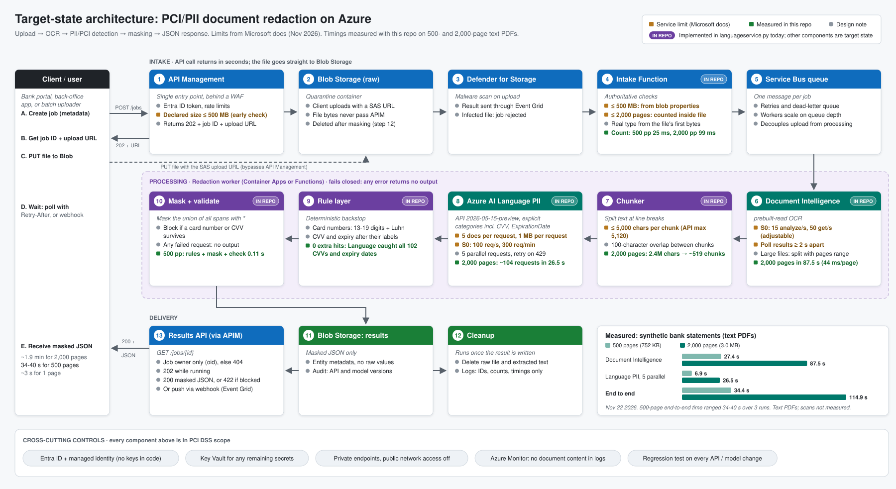

# Target-state architecture: PCI/PII document redaction on Azure

This page explains the end-to-end flow, from a user creating a job to that user receiving masked JSON. The size and page checks from step 4, and steps 6 to 10, are implemented in [`languageservice.py`](../languageservice.py) today. The other steps describe the target production design.



This is the logical view. For the service-by-service implementation with Azure icons, including exactly what API Management does, see [Technical implementation on Azure](technical-architecture.md).

The diagram is generated by [`scripts/render_architecture.py`](../scripts/render_architecture.py). Edit the script and re-run it rather than editing the SVG by hand.

- **Limits** come from Microsoft's documentation, checked in November 2026: [Document Intelligence limits](https://learn.microsoft.com/en-us/azure/ai-services/document-intelligence/service-limits) and [Language data limits](https://learn.microsoft.com/en-us/azure/ai-services/language-service/concepts/data-limits).
- **Timings** were measured with this repo on realistic synthetic statement batches of 500 pages (752 KB) and 2,000 pages (3.0 MB), against the `idpdocgta` (Document Intelligence S0) and `idpgtalangll` (Language S) resources on November 22, 2026. Where a measurement was repeated, the range is shown.
- **Service limits were tested live**, with screenshots: see [Service limit evidence](../README.md#service-limit-evidence).

## The flow in brief

1. The client creates a job through API Management, sending only metadata (file name, declared size, type). It gets back a job ID and a short-lived upload URL.
2. The client uploads the file straight to Blob Storage with that URL. The file never passes through API Management.
3. Defender for Storage scans the file for malware. A clean result triggers the Intake Function, which checks the real size, file type, and page count, then queues the job.
4. A worker picks up the job:
   - Document Intelligence turns the file into text.
   - The text is split into chunks the Language service can accept.
   - The Language service and a set of deterministic rules find every sensitive value.
   - Those values are masked, and a final check confirms no card number or CVV survived.
5. The masked JSON is stored, the original file and extracted text are deleted, and the client collects the result with the job ID.

If anything goes wrong in the worker, the job fails, and no partially masked text is ever returned.

## Sequence

```mermaid
sequenceDiagram
    autonumber
    actor U as Client / user
    participant A as API Management
    participant B as Blob Storage (raw)
    participant I as Intake Function
    participant Q as Service Bus
    participant W as Redaction worker
    participant D as Document Intelligence
    participant L as Azure AI Language
    participant R as Blob Storage (results)

    U->>A: POST /jobs (metadata only: name, declared size, type)
    A->>A: Validate token, rate limit, declared size ≤ 500 MB and type
    A-->>U: 202 Accepted + job ID + upload URL (SAS)
    U->>B: PUT file with the upload URL
    B->>B: Defender for Storage malware scan
    B->>I: Clean scan result (Event Grid)
    I->>I: Size ≤ 500 MB (blob properties), real type, pages ≤ 2,000 (99 ms for 2,000 pages)
    I->>Q: Enqueue job
    Q->>W: Deliver job
    W->>D: Analyze (prebuilt-read)
    D-->>W: Extracted text (2,000 pages: 87.5 s)
    W->>W: Check page count matches; chunk ≤ 5,000 chars, 100-char overlap
    par 5 parallel requests, 5 chunks each
        W->>L: PII detection (preview API, explicit categories)
        L-->>W: Entities (2,000 pages: about 104 requests, 26.5 s)
    end
    W->>W: Rule layer, mask, validate (500 pages: 0.11 s)
    W->>R: Store masked JSON
    W->>B: Delete raw file and extracted text
    U->>A: GET /jobs/{id}
    A-->>U: 200 + masked JSON (about 1.9 min after upload for 2,000 pages)
```

## Step by step

### Intake (the API call returns in seconds)

| Step | Component | What it does | Limits and numbers |
|------|-----------|--------------|--------------------|
| 1 | **API Management** | Single entry point, behind a web application firewall. Validates the caller's Microsoft Entra ID token, applies rate limits, rejects declared sizes over 500 MB or unsupported types, and returns `202 Accepted` with a job ID and a short-lived upload URL (issued by a Create-job Function) | Receives metadata only, so the response is fast regardless of file size. The declared size is an early check only, because the client supplies it |
| 2 | **Blob Storage (raw)** | Receives the file directly from the client through the upload URL, in a quarantine container | The upload URL is write-only, for one blob, and expires quickly. Private endpoint for internal access, encrypted at rest. The file is deleted in step 12, and a lifecycle rule removes anything left behind |
| 3 | **Defender for Storage** | Scans the upload for malware and publishes the result as a blob index tag and an Event Grid event | An infected file rejects the job before any processing |
| 4 | **Intake Function** | Runs on the clean scan result. Applies the authoritative checks: real size, real file type, page count. See [How the size and page checks work](#how-the-size-and-page-checks-work) | Max 500 MB and 2,000 pages per document. Both are hard limits for Document Intelligence S0 and can't be raised. **Measured:** counting pages took 24 to 26 ms for the 500-page batch, and 57 to 99 ms for 2,000-page PDFs depending on file size (99 ms for the 3.0 MB batch). A 2,001-page PDF is rejected with no Azure AI call. **This check is essential:** Document Intelligence itself does not reject files over 2,000 pages ([tested](../README.md#service-limit-evidence)) |
| 5 | **Service Bus queue** | One message per job | Separates upload from processing, so a slow 2,000-page job never blocks an API call. Gives retries and a dead-letter queue |

#### How the size and page checks work

The checks are split between API Management and the Intake Function, because API Management never sees the file:

| Check | Where it runs | Why there |
|-------|---------------|-----------|
| Caller identity (Entra ID token) | API Management (step 1) | Every request passes through it. Authoritative |
| Rate limit and quota per client | API Management (step 1) | Same. Authoritative |
| Declared size ≤ 500 MB, allowed file type | API Management (step 1) | Cheap early rejection before any upload. Not authoritative, because the client declares these values |
| Malware | Defender for Storage (step 3) | Scans the stored file. Authoritative |
| Actual size ≤ 500 MB | Intake Function (step 4) | Read from the blob's properties without opening the file. Authoritative |
| Real file type | Intake Function (step 4) | Detected from the file's first bytes, so a renamed file can't skip the checks. Authoritative |
| Pages ≤ 2,000 | Intake Function (step 4) | Requires opening the file and counting. Authoritative |
| Anything the checks missed | Document Intelligence (step 6) | Rejects files over its own limits. The backstop |

**Why API Management can't count pages.** The file never reaches it: the client uploads straight to Blob Storage. Even if it did, API Management policies can't parse PDF or TIFF structure, and its `validate-content` policy only inspects small request bodies (100 KiB). Request payload limits also vary by tier; Microsoft's Q&A reports 2 MiB on the Consumption tier ([source](https://learn.microsoft.com/en-us/answers/questions/1808898/http-request-limits)). Routing a 500 MB file through API Management would hit those limits and add cost, which is why the upload goes directly to Blob Storage. This is sometimes called the valet key pattern.

**How the Intake Function counts pages.** Size is known without opening the file. Pages are not in any header, so the function opens the file and counts them, without rendering anything:

| File type | How pages are counted | Implemented in `languageservice.py` |
|-----------|-----------------------|-------------------------------------|
| PDF | Length of the PDF's internal page list, read with `pypdf` | Yes |
| TIFF | Number of image frames, read with Pillow | Yes |
| JPEG, PNG, BMP, HEIF | Always 1 page | Yes |
| PPTX | Number of slides in the file. Microsoft counts each slide as one page | No |
| XLS | Number of worksheets. Microsoft counts each worksheet as one page | No |
| DOCX | No reliable page count is stored in the file. Microsoft's billing docs count Word documents in blocks of 3,000 characters, so a character count gives an estimate. Not confirmed to be how the 2,000-page limit is applied | No |

When the count can't be determined, the Intake Function doesn't reject the file. That covers encrypted or damaged PDFs and the unimplemented types. Document Intelligence still enforces its own limits in step 6, and the pipeline returns its error as `{"status": "error"}`.

In this repo, `precheck()` in `languageservice.py` implements the Intake Function's checks and runs before any Azure call.

### Processing (asynchronous, inside the redaction worker)

The worker is an Azure Function, triggered by each Service Bus message, and scales with queue depth. It **fails closed**: any error ends the job with no output.

- **Hosting plan:** a 2,000-page text PDF took about 2 minutes end to end, and scanned documents will take longer. Choose a Functions plan whose execution timeout and memory fit your largest documents. Flex Consumption or Premium allow longer runs than the basic Consumption plan. Check the current limits for each plan before choosing.
- **The file isn't loaded into the Function:** the worker passes Document Intelligence a short-lived read URL for the blob, so the Function only holds the extracted text (about 2.4 MB for 2,000 pages), not a file of up to 500 MB. `languageservice.py` doesn't do this yet; it uploads the file bytes.
- **When to use Azure Container Apps instead:** if testing with real scanned documents shows jobs exceeding the Functions plan's time or memory limits, or if your organization standardizes on containers. The worker code doesn't change, only where it runs.

| Step | Component | What it does | Limits and numbers |
|------|-----------|--------------|--------------------|
| 6 | **Document Intelligence** (`prebuilt-read`) | Runs OCR and returns all text in the file | **Limits:** 15 analyze requests per second and 50 get-result requests per second by default on S0 (both adjustable). Microsoft recommends polling for results no more than once every 2 seconds. **Measured:** 500 pages in 27.4 to 28.5 s (3 runs), and 2,000 pages in 87.5 s (44 ms per page) in a single call. **Tested:** a 2,001-page file is not rejected; only the first 2,000 pages are analyzed, with no error, so the worker checks the returned page count and fails closed on a mismatch. **Large files:** split into page ranges with the `pages` parameter so a failure only retries one range |
| 7 | **Chunker** | Splits the text at line breaks so the Language service can accept it | **Limits:** the Language sync API takes at most 5,120 characters per document, so chunks are capped at 5,000. Consecutive chunks overlap by 100 characters so a value cut at a boundary is still seen whole. **Measured:** 500 pages: 598,991 characters became 128 chunks. 2,000 pages: 2,437,253 characters became about 519 chunks |
| 8 | **Azure AI Language, PII detection** | Finds sensitive values. Uses API `2026-05-15-preview` with an explicit category list that includes `CreditCardNumber`, `CVV`, `ExpirationDate`, bank and tax IDs, and personal data | **Limits:** 5 documents and 1 MB per request. S0 allows 100 requests per second and 300 per minute; S allows 1,000 and 1,000. **This design:** 5 chunks per request, 5 requests in parallel, retry on `429` honoring `Retry-After`. **Measured:** 500 pages: 26 requests in 6.5 to 11.6 s (3 runs), against 24.4 s one at a time. 2,000 pages: about 104 requests in 26.5 s, about 235 per minute |
| 9 | **Rule layer** | Deterministic backstop that doesn't depend on a model: card numbers (13 to 19 digits that pass the Luhn check), and CVVs and expiry dates that follow their labels | **Measured:** 0 extra hits on the test set, because the Language service caught all 102 planted card numbers, CVVs, and expiry dates across both batches. The rules guard against layouts the service handles less well |
| 10 | **Mask + validate** | Masks the union of every span from steps 8 and 9 with `*`, then re-checks the masked text. In block mode, a document with card data returns `blocked` and no text instead | Blocks the job if any card number or labeled CVV survives. **Measured:** steps 9 and 10 together take 0.11 s for 500 pages |

### Delivery

| Step | Component | What it does | Limits and numbers |
|------|-----------|--------------|--------------------|
| 11 | **Blob Storage: results** | Stores the masked JSON (or the blocked verdict): masked text, entity categories, positions, confidence, and the API and model versions used | Never stores raw values |
| 12 | **Cleanup** | Deletes the raw file and the extracted text once the result is written | Logs contain only job IDs, counts, timings, and versions |
| 13 | **Results API** (through API Management) | `GET /jobs/{id}` answers only the caller who created the job, and `404` to anyone else. It returns `202` while the job runs, `200` with the masked JSON when it's done, and `422` if the document was blocked. Alternatively, push a webhook through Event Grid | **Measured end to end:** about 3 s for a 1-page form, 34 to 40 s for 500 pages, and 115 s (about 1.9 minutes) for 2,000 pages |

### Cross-cutting controls

Every component above handles card data or its derivatives, so all of them are in PCI DSS scope:

- **Identity:** Microsoft Entra ID and managed identities between services, with no keys in code. Key Vault for any secrets that remain.
- **Network:** private endpoints for Blob Storage, Service Bus, Document Intelligence, and Language, with public network access turned off.
- **Logging:** Azure Monitor receives job IDs, page counts, entity counts by category, timings, and versions. Document text and entity values are never logged, including in the services' diagnostic settings.
- **Regression testing:** a labeled test set (like `scripts/generate_banking_pdf.py` plus `scripts/score_results.py`) re-run whenever the Language API or model version changes. CVV and expiry detection rely on preview features that can change.

## Time budget for 500- and 2,000-page documents

| Stage | 500 pages | Share | 2,000 pages | Share |
|-------|-----------|-------|-------------|-------|
| Size and page check (4) | 62 ms | under 1% | 138 ms | under 1% |
| API call, upload, malware scan, queue (1 to 3, 5) | Not measured. Expect seconds, dominated by upload bandwidth | | Not measured | |
| Document Intelligence (6) | 27.4 s | 80% | 87.5 s | 76% |
| Chunking (7) | Not timed separately. It's string slicing in memory, negligible next to the network calls | | Not timed separately | |
| Language PII, 5 parallel (8) | 6.9 s | 20% | 26.5 s | 23% |
| Rules, masking, validation (9, 10) | 0.11 s | under 1% | Not timed separately | about 1% with start-up |
| **Processing total** | **34.4 s** | | **114.9 s** | |

- **500-page column:** from `scripts/benchmark.py`. Across three runs, Document Intelligence took 27.4 to 28.5 s and the total was 34.4 to 40.3 s.
- **2,000-page column:** from one `python languageservice.py` run, measured as wall-clock time.

Document Intelligence takes three quarters or more of the time at both sizes once Language calls run in parallel. To go faster on very large files, split them into page ranges and run those Document Intelligence calls in parallel, within the 15 requests-per-second limit. This wasn't measured here, so benchmark it on your own documents. Scanned PDFs need full OCR and will be slower than the text PDFs measured here.

## What happens when something fails

| Failure | Where | Outcome |
|---------|-------|---------|
| Declared size over 500 MB, or an unsupported declared type | Step 1 | Rejected by API Management before any upload |
| Actual file over 500 MB or 2,000 pages, or a disallowed real type | Step 4 | Job rejected with a clear error, for example `File has 2,001 pages; the limit is 2,000 pages`. The blob is deleted and no Azure AI service is called |
| Page count can't be read (encrypted or damaged PDF, or a type the Intake Function doesn't count) | Step 4, then step 6 | The Intake Function lets the file through, and Document Intelligence enforces the limit. Its error is returned as `{"status": "error"}` |
| Malware detected | Step 3 | Job rejected, blob deleted |
| Document Intelligence analyzed fewer pages than the file has | Step 6 | Job fails closed with `Document Intelligence analyzed N of M pages`. Without this check, pages past 2,000 would be silently skipped (tested) |
| Document Intelligence error | Step 6 | Job fails. Service Bus retries, then moves the message to the dead-letter queue |
| Connection dropped (DNS, TLS, timeout) | Step 6 or 8 | Job fails with an error and no output. Seen once in testing, before the 2,000-page upload. An immediate retry succeeded, so retry the whole job a limited number of times |
| Language returns `429` or `5xx` | Step 8 | Retried with backoff, honoring `Retry-After`. Fails the job after 5 attempts |
| Language returns an error for any chunk | Step 8 | Job fails. A document is never returned with some chunks unmasked |
| A card number or CVV survives masking | Step 10 | Job fails and an alert is raised. Treat it as a defect in the detectors |
| No text found (for example, a blank scan) | Step 6 | Returns `status: no_text` |
| Card data found in block mode | Step 10 | Returns `status: blocked` (HTTP `422`) with no text |
| A caller asks for someone else's job | Step 13 | `404`, the same as for a job that doesn't exist |
