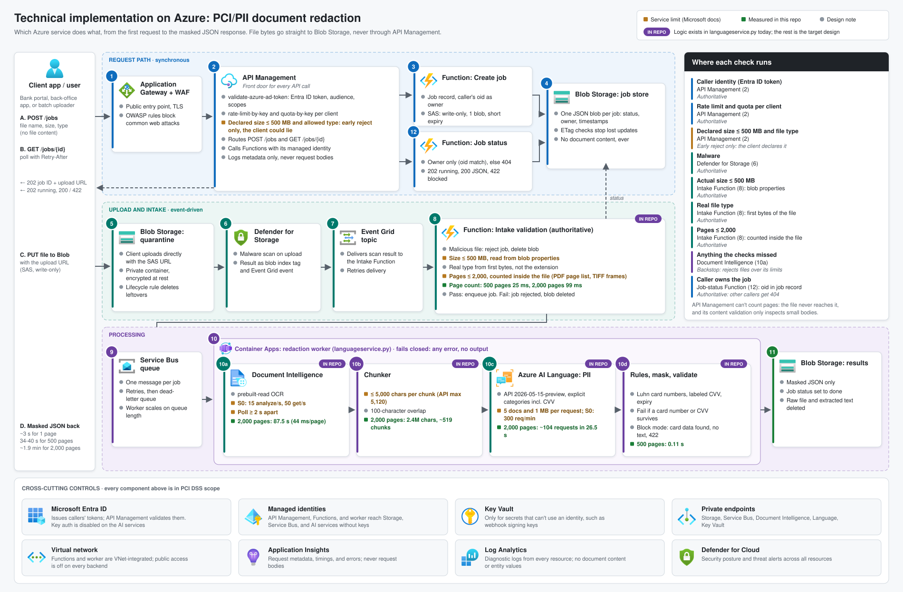

# Technical implementation on Azure

This page shows which Azure service does what, from the client's first request to the masked JSON response. It is the implementation view of the [target-state architecture](architecture.md).



The diagram is generated by [`scripts/render_technical_architecture.py`](../scripts/render_technical_architecture.py), using Microsoft's official Azure architecture icons from [`icons/azure/`](icons/azure/). Components tagged **IN REPO** have their logic in `languageservice.py` today. Everything else is the target design and has not been deployed or tested.

## Key design decision: the file never passes through API Management

The client sends only metadata to API Management, then uploads the file directly to Blob Storage with a short-lived, write-only upload URL (a SAS). This is sometimes called the valet key pattern. It's needed for three reasons:

- **Payload limits.** API Management request payload limits vary by tier. Microsoft's Q&A reports 2 MiB on the Consumption tier ([source](https://learn.microsoft.com/en-us/answers/questions/1808898/http-request-limits)). Documents can be up to 500 MB.
- **No content inspection at this size.** The `validate-content` policy only inspects bodies up to 100 KiB, and no policy can parse PDF or TIFF structure to count pages.
- **Cost and latency.** Streaming hundreds of megabytes through the gateway adds load and cost for no benefit.

The authoritative file checks therefore run in the Intake Function, after the file is stored and scanned.

## Request flow

| Step | Azure service | What it does | Limits and numbers |
|------|---------------|--------------|--------------------|
| 1 | **Application Gateway with WAF** | Public entry point. Terminates TLS and applies web application firewall rules before traffic reaches API Management | |
| 2 | **API Management** | Validates the caller, applies rate limits, rejects bad metadata, and routes `POST /jobs` and `GET /jobs/{id}` to Functions. See [What API Management does](#what-api-management-does) | Metadata only. Declared size ≤ 500 MB is checked here as an early rejection, not as the final check |
| 3 | **Function: Create job** | Creates the job record with status `awaiting_upload`, and issues a SAS upload URL: write-only, scoped to one blob, short expiry | |
| 4 | **Cosmos DB: job store** | Holds job status, timestamps, and counts | Never holds document content or entity values |
| 5 | **Blob Storage: quarantine container** | Receives the file directly from the client | Lifecycle rule deletes anything left behind |
| 6 | **Defender for Storage** | Scans each upload for malware. Publishes the result as a blob index tag and as an Event Grid event | |
| 7 | **Event Grid topic** | Delivers the scan result to the Intake Function, with retries | |
| 8 | **Function: Intake validation** (IN REPO: `precheck()`) | On a malicious result, rejects the job and deletes the blob. On a clean result, checks the real size from blob properties, the real file type from the first bytes, and the page count from inside the file. Then enqueues the job, or rejects it and deletes the blob | ≤ 500 MB and ≤ 2,000 pages. **Measured:** page count 24 to 26 ms for 500 pages, 99 ms for the 3.4 MB 2,000-page statement |
| 9 | **Service Bus queue** | One message per job. Retries, then dead-letters | The worker scales on queue length |
| 10 | **Container Apps: redaction worker** (IN REPO: `languageservice.py`) | Runs steps 10a to 10d and fails closed on any error | |
| 10a | **Document Intelligence**, `prebuilt-read` | Extracts the text | S0: 15 analyze and 50 get-result requests per second, polling at most every 2 s. **Measured:** 2,000 pages in 108.8 s |
| 10b | Chunker (code) | Splits the text at line breaks with 100 characters of overlap | ≤ 5,000 characters per chunk (Language limit 5,120). **Measured:** 2,000 pages became about 434 chunks |
| 10c | **Azure AI Language**, PII detection | Finds sensitive values with API `2026-05-15-preview` and explicit categories, including `CVV` | 5 documents and 1 MB per request; S0 allows 300 requests per minute. **Measured:** 87 requests in 36.7 s, 5 in parallel |
| 10d | Rules, mask, validate (code) | Luhn-checked card numbers, labeled CVVs and expiry dates; masks everything found; fails if a card number or CVV survives | **Measured:** 0.09 s for 500 pages |
| 11 | **Blob Storage: results container** | Stores the masked JSON. The worker sets the job to `succeeded` and deletes the raw file and extracted text | |
| 12 | **Function: Job status** | Serves `GET /jobs/{id}`: `202` with the status while running, `200` with the masked JSON when done | **Measured end to end:** about 3 s for 1 page, 39 to 54 s for 500 pages, about 2.5 minutes for 2,000 pages |

## What API Management does

API Management is the only public API surface. It handles everything that can be decided from the request alone, before any storage or compute is used.

| Responsibility | API Management policy | Notes |
|----------------|-----------------------|-------|
| Authenticate the caller | `validate-jwt` | Checks the Microsoft Entra ID token's signature, issuer, audience, and required scopes |
| Protect capacity | `rate-limit-by-key`, `quota-by-key` | Per client, keyed on the token's client ID. Keeps one caller from exhausting the Document Intelligence and Language quotas |
| Reject bad metadata early | `choose` + `return-response` | Declared `sizeBytes` over 524,288,000 (500 MB) returns `413`. A `contentType` outside the allowed list returns `415`. The Intake Function re-checks both against the real file |
| Route | `set-backend-service` | `POST /jobs` to the Create-job Function, `GET /jobs/{id}` to the Job-status Function |
| Call the backend without secrets | `authentication-managed-identity` | API Management gets a token for the Function app with its managed identity |
| Keep content out of logs | Diagnostic settings | Log request metadata only. Turn off request and response body logging |

An illustrative policy for `POST /jobs` follows. It has not been deployed or tested. Replace the placeholders, and validate it in your API Management instance before use.

```xml
<policies>
  <inbound>
    <base />
    <validate-jwt header-name="Authorization" failed-validation-httpcode="401">
      <openid-config url="https://login.microsoftonline.com/{tenant-id}/v2.0/.well-known/openid-configuration" />
      <audiences><audience>api://{redaction-api-app-id}</audience></audiences>
      <required-claims>
        <claim name="scp" match="any"><value>Jobs.Create</value></claim>
      </required-claims>
    </validate-jwt>
    <rate-limit-by-key calls="60" renewal-period="60"
        counter-key="@(context.Request.Headers.GetValueOrDefault("Authorization","").AsJwt()?.Claims.GetValueOrDefault("azp", "anonymous"))" />
    <set-variable name="sizeBytes" value="@((long)context.Request.Body.As<JObject>(preserveContent: true)["sizeBytes"])" />
    <choose>
      <when condition="@((long)context.Variables["sizeBytes"] > 524288000)">
        <return-response>
          <set-status code="413" reason="Payload Too Large" />
          <set-body>{"error": "File exceeds the 500 MB limit"}</set-body>
        </return-response>
      </when>
    </choose>
    <set-backend-service backend-id="create-job-function" />
    <authentication-managed-identity resource="api://{function-app-id}" />
  </inbound>
  <backend><base /></backend>
  <outbound><base /></outbound>
  <on-error><base /></on-error>
</policies>
```

The rate limit of 60 calls per minute is a placeholder. Size it from your Language and Document Intelligence quotas: see [Throughput and rate limits](../README.md#4-throughput-and-rate-limits).

## API contract

| Call | Request | Response |
|------|---------|----------|
| `POST /jobs` | JSON metadata: `fileName`, `sizeBytes`, `contentType` | `202` with `jobId`, `uploadUrl` (SAS), and `uploadUrlExpiresAt`. Or `401`, `413`, `415`, `429` |
| `PUT {uploadUrl}` | The file, sent directly to Blob Storage | `201` from Blob Storage |
| `GET /jobs/{id}` | None | `202` with `status` (`awaiting_upload`, `scanning`, `queued`, `processing`) and a `Retry-After` header. `200` with the masked JSON when `succeeded`. `200` with `status: rejected` or `failed` and a reason, never document content |

## Identity and network

No component uses keys. Each one uses its managed identity with the narrowest built-in role:

| Component | Needs access to | Built-in role |
|-----------|-----------------|---------------|
| API Management | Function apps | Function-level Entra ID authentication |
| Create-job Function | Blob Storage (to issue a user-delegation SAS), Cosmos DB | Storage Blob Delegator; Cosmos DB Built-in Data Contributor |
| Intake Function | Quarantine container, Service Bus, Cosmos DB | Storage Blob Data Contributor; Azure Service Bus Data Sender; Cosmos DB Built-in Data Contributor |
| Redaction worker | Quarantine and results containers, Service Bus, Document Intelligence, Language, Cosmos DB | Storage Blob Data Contributor; Azure Service Bus Data Receiver; Cognitive Services User; Cosmos DB Built-in Data Contributor |
| Job-status Function | Results container, Cosmos DB | Storage Blob Data Reader; Cosmos DB Built-in Data Reader |

Network:

- **Private endpoints** for Blob Storage, Service Bus, Cosmos DB, Document Intelligence, Language, and Key Vault, with public network access turned off on each.
- **VNet integration** for the Functions and the Container Apps environment, so they reach those private endpoints.
- **Exception:** the client's SAS upload needs a reachable Blob endpoint. Either allow public access on the quarantine storage account only, restricted to SAS uploads, or give clients a private network path. This is a design decision for your security team.

## What exists in this repo today

| Component | Status |
|-----------|--------|
| Intake checks (step 8) | `precheck()` in `languageservice.py`: size, real type, page count |
| Redaction worker (steps 10a to 10d) | `languageservice.py`, run as a command-line tool |
| Everything else: Application Gateway, API Management, Functions, Cosmos DB, Blob containers, Defender, Event Grid, Service Bus, identities, private networking | Target design. Not deployed or tested |
